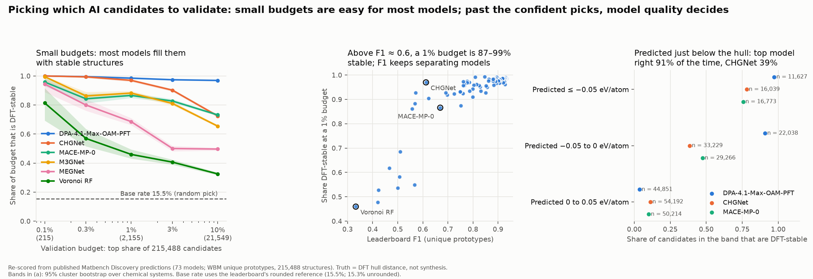

# Materials Intelligence: From Research to Market

**A market-led strategy for AI materials discovery, scientific validation, and commercialization**

中文在上，[English below](#english-version)。

> 状态：v0.1，2026-11-21。由外向内的分析，只用公开资料，不代表 Google DeepMind 或任何公司的实际计划。所有建议都是推断，并在文中标出；没有核实的数字标为未核实。

## 这个项目做什么

核心问题：

> 根据公开证据，如果要把 AI 材料发现能力转化为产业影响，应该优先进入哪些市场、解决哪些技术瓶颈、选择什么商业模式，以及如何配置研究和实验资源？

做法是三层：市场层给出买家的门槛；技术层复现公开的评测，找到结论不再成立的地方；决策层把两者合成投资建议。项目不提出新算法或新基准，而是检验已有的研究和评测，再把证据变成资源决策。

## 结果一览

| 模块 | 做了什么 | 主要发现 | 报告 |
|---|---|---|---|
| 固态电池电解质 | 把 OBELiX 的 499 个实测组成当离线实验室，比较六种选材策略需要的实验次数 | 已知化学家族里，先验实测数据省下的实验远多于算法之间的差别；把同一掺杂系列整个留出后，机器学习只比"先测硫化物"的经验规则多省 3–4 次实验；迁移到新家族对硫化物有效、对氧化物无效 | [modules/battery/REPORT.md](modules/battery/REPORT.md) |
| 芯片散热 | 重新计分 Matbench Discovery 上 62 个模型的 κ_SRME，加经验规则基线和 7 个材料的实测对照 | 在 103 个简单二元化合物上，较好的模型对高导热候选的排序几乎一致，但测试集太容易，不能说明发现问题已解决；DFT 参考值对 7 个材料里的 6 个比实测低 10–27% | [modules/thermal/REPORT.md](modules/thermal/REPORT.md) |
| 稳定性筛选与 CSP | 重新计分 73 个模型的稳定性预测，按"给定验证预算挑哪些结构"来读；审计一篇 CSP 基准论文 | 1% 预算下 48 个模型挑到至少 95% DFT 稳定的结构（随机 15.5%）；超出模型有把握的候选后，模型之间差别很大；CSP 基准上生成模型没有超过模板方法 | [modules/csp/REPORT.md](modules/csp/REPORT.md) |

两个重新计分的模块都和官方排行榜逐个对上（κ_SRME：62 个模型；稳定性：146 组指标），并有逐材料、逐结构对照官方逻辑的测试。

**商业证据关卡。** 两个方向各做了一次事先定好退出条件的需求检验：只问四个问题、只认一手来源、最多 30 次检索。
- [芯片散热](modules/thermal/COMMERCIAL_EVIDENCE_GATE.md)：问题和规模有一手依据，验收指标已知；但买家一侧都指向冷却架构，没有一手证据表明需要新材料，方向降为观察。
- [固态电池](modules/battery/COMMERCIAL_EVIDENCE_GATE.md)：规则在检索前提交到 git（commit `80f062e`）。买家侧的电芯级验收指标找到了；买家点名的材料限制是界面耐久性，不是电导率；没有买家侧的电导率门槛。

**决策。** 11 项投入的决定、继续条件和停止条件在 [data/board/decisions.csv](data/board/decisions.csv)，看板里可以按方向查看。简短地说：近期只批准便宜、能快速检验的投入；更大规模的晶体筛选暂缓，芯片散热观察，和电池厂的合作只谈联合探索。



## 证据规则

每个模块都按同一套规则做：
- **运行前登记。** 设计写进运行目录的 `config.json`，再读任何预测或结果；事后加的分析单独标明。
- **基线不只是随机。** 包括领域经验规则或老一代模型。
- **独立审查。** 每个模块跑完都请独立代理审查代码和结论，修正记录在各报告末尾；作废的运行以 `superseded_` 开头保留。
- **来历记录。** 每次运行记录输入文件哈希、代码哈希、包版本、种子，以及 git commit。
- **复现层级写清楚。** 区分"重新计分""重新推理""重新训练"；本项目只到重新计分，没有重算声子或结构弛豫。

## 投资组合看板

只读的 Streamlit 应用，中英文切换：总览（每个方向的三个独立证据维度，不合成总分）、方向详情（六道关卡和每条证据的出处与核实状态）、决策、模块结果。

```bash
.venv/bin/streamlit run board/app.py
```

## 复现

需要 Python 3.12。原始数据不在仓库里，由脚本按固定的版本和 md5 下载（约 0.9 GB）。

```bash
python3.12 -m venv .venv
.venv/bin/pip install -r requirements.txt

# 固态电池
.venv/bin/python -I src/battery/fetch_obelix.py
.venv/bin/python src/battery/run_experiment.py
.venv/bin/python src/battery/analyze.py results/<run_id>

# 芯片散热
.venv/bin/python -I src/thermal/fetch_kappa.py
.venv/bin/python src/thermal/run_rescore.py
.venv/bin/python src/thermal/analyze_thermal.py results/<run_id>

# 稳定性筛选
.venv/bin/python -I src/csp/fetch_discovery.py
.venv/bin/python src/csp/run_screening.py
.venv/bin/python src/csp/analyze_boundaries.py results/<run_id>

# 对照官方实现
.venv/bin/python tests/check_thermal_official_port.py data/raw/kappa/<commit> results/<thermal_run_id>
.venv/bin/python tests/check_csp_official_port.py
```

每个模块报告末尾有完整的命令，包括画图。

## 仓库结构

```
board/          投资组合看板（Streamlit，只读）
data/board/     看板的数据：方向、证据（带出处和核实状态）、决策、关卡
data/battery/   电池关卡的一手来源
data/thermal/   散热的实测值和文献来源
modules/        三个模块的报告和两个商业证据关卡（中文在上、英文在下）
src/            每个模块的下载、运行、分析和画图脚本
results/        每次运行的配置、来历记录、原始输出和图
tests/          逐材料、逐结构对照官方计分逻辑的检查
memo/           决策备忘录的索引
PRODUCT_PLAN.md 最初的落地方案（2026-11-20），保留作为记录
```

## 数据来源和许可

| 来源 | 用途 | 许可 |
|---|---|---|
| [OBELiX](https://github.com/NRC-Mila/OBELiX)（commit `4eaac88`） | 实测离子电导率 | CC BY 4.0 |
| [Matbench Discovery](https://github.com/janosh/matbench-discovery)（commit `6d587c1`） | WBM 测试集、各模型的公开预测、κ_SRME 参考值 | 代码 MIT；数据见上游仓库 |
| Materials Project（经 Matbench Discovery 下载） | 结构类型标签、2023 年快照的编号 | 见上游说明 |
| 文献和公司公开材料 | 实测值、需求侧证据 | 只记录事实和出处链接，见 `data/*/literature_sources.csv`；关卡文件里的原文引用都不超过 25 词 |

本仓库不重新分发任何原始数据。

代码（`src/`、`board/`、`tests/`）采用 MIT 许可，见 [LICENSE](LICENSE)。报告、备忘录、关卡文件和本项目整理的证据表不在 MIT 许可范围内；第三方数据沿用上游许可。

## 局限

- 两个重新计分的模块，真值都是 DFT，不是合成或实测。
- 电池回测的"实验次数"是读出已发表的数，不是实验成本；没有任何一项投入的真实成本数据。
- 市场层的很多数字来自一个未公开的系列文章，还没有核实，看板里用灰色标出。
- 三种视角（科学验证、商业策略、S&O）只用来组织问题，不代表任何人的意见。

---

## English version

> Status: v0.1, 21 November 2026. An outside-in analysis using public information only; it does not represent the plans of Google DeepMind or any company. Every recommendation is an inference and is marked as such; unverified numbers are marked unverified.

### What this project does

Core question:

> Based on public evidence, to turn AI materials-discovery capability into industrial impact, which markets should come first, which technical bottlenecks should be solved, which business model should be chosen, and how should research and lab resources be allocated?

The approach has three layers: the market layer gives buyers' thresholds; the technical layer reproduces public benchmarks and finds where their conclusions stop holding; the decision layer combines both into investment recommendations. The project does not propose new algorithms or benchmarks; it tests existing research and benchmarks, then turns the evidence into resource decisions.

### Results at a glance

| Module | What was done | Main findings | Report |
|---|---|---|---|
| Solid-state electrolytes | Used 499 measured OBELiX compositions as an offline lab and compared how many experiments six selection policies need | In known chemical families, prior measured data saves far more experiments than the differences between algorithms; with whole doping series held out, ML saves only 3–4 more experiments than a "test sulfides first" rule; transfer to a new family works for sulfides and fails for oxides | [modules/battery/REPORT.md](modules/battery/REPORT.md) |
| Chip cooling | Re-scored 62 models on Matbench Discovery's κ_SRME, with a rule-of-thumb baseline and measured values for 7 materials | On 103 simple binary compounds, the better models rank high-conductivity candidates almost identically, but the test set is too easy to show that discovery is solved; the DFT reference is 10–27% below measurement for 6 of 7 materials | [modules/thermal/REPORT.md](modules/thermal/REPORT.md) |
| Stability screening & CSP | Re-scored the stability predictions of 73 models, read as "which structures to pick for a given validation budget"; audited one CSP benchmark paper | At a 1% budget, 48 models pick at least 95% DFT-stable structures (random: 15.5%); past the candidates a model is confident about, models differ a lot; on the CSP benchmark, generative models do not beat a template method | [modules/csp/REPORT.md](modules/csp/REPORT.md) |

Both re-scoring modules match the official leaderboard value by value (κ_SRME: 62 models; stability: 146 metric sets), with tests that compare against the official logic per material and per structure.

**Commercial evidence gates.** Each of two directions had one demand check with exit conditions set in advance: four questions only, primary sources only, at most 30 searches.
- [Chip cooling](modules/thermal/COMMERCIAL_EVIDENCE_GATE.md): the problem and its scale have primary support and the acceptance metric is known; but buyer-side sources all point to cooling architecture, with no primary evidence that a new material is needed, so the direction moved to watch.
- [Solid-state electrolytes](modules/battery/COMMERCIAL_EVIDENCE_GATE.md): the rules were committed to git before any search (commit `80f062e`). Buyer-side cell-level acceptance metrics were found; the material limit buyers name is interface durability, not conductivity; there is no buyer-side conductivity threshold.

**Decisions.** The decision, continue condition and stop condition for 11 investments are in [data/board/decisions.csv](data/board/decisions.csv) and can be browsed by direction on the board. In short: near term, approve only cheap investments that can be checked quickly; defer larger-scale crystal screening, watch chip cooling, and limit a battery partnership to joint exploration.


### Evidence rules

Every module follows the same rules:
- **Pre-registration.** The design is written to the run's `config.json` before any prediction or result is read; analyses added afterwards are labelled post-hoc.
- **Baselines beyond random.** They include a domain rule of thumb or older models.
- **Independent review.** After each module ran, an independent agent reviewed the code and the conclusions; the fixes are recorded at the end of each report, and superseded runs are kept with a `superseded_` prefix.
- **Provenance.** Each run records input-file hashes, code hashes, package versions, seeds and the git commit.
- **Stated reproduction level.** "Re-score", "re-infer" and "retrain" are kept apart; this project only re-scores and does not recompute phonons or structure relaxations.

### Portfolio board

A read-only Streamlit app with a Chinese/English toggle: overview (three independent evidence dimensions per direction, no total score), direction detail (six gates, with the source and verification status of every evidence row), decisions, and module results.

```bash
.venv/bin/streamlit run board/app.py
```

### Reproduction

Requires Python 3.12. Raw data is not in the repository; scripts download it at pinned versions with md5 checks (about 0.9 GB).

```bash
python3.12 -m venv .venv
.venv/bin/pip install -r requirements.txt

# Solid-state electrolytes
.venv/bin/python -I src/battery/fetch_obelix.py
.venv/bin/python src/battery/run_experiment.py
.venv/bin/python src/battery/analyze.py results/<run_id>

# Chip cooling
.venv/bin/python -I src/thermal/fetch_kappa.py
.venv/bin/python src/thermal/run_rescore.py
.venv/bin/python src/thermal/analyze_thermal.py results/<run_id>

# Stability screening
.venv/bin/python -I src/csp/fetch_discovery.py
.venv/bin/python src/csp/run_screening.py
.venv/bin/python src/csp/analyze_boundaries.py results/<run_id>

# Checks against the official implementation
.venv/bin/python tests/check_thermal_official_port.py data/raw/kappa/<commit> results/<thermal_run_id>
.venv/bin/python tests/check_csp_official_port.py
```

Each module report ends with its full command list, including plotting.

### Repository layout

```
board/          portfolio board (Streamlit, read-only)
data/board/     board data: directions, evidence (with source and verification status), decisions, gates
data/battery/   primary sources for the battery gate
data/thermal/   measured values and literature sources for chip cooling
modules/        reports for the three modules and the two commercial evidence gates (Chinese first, English below)
src/            download, run, analysis and plotting scripts per module
results/        per-run configuration, provenance, raw outputs and figures
tests/          per-material and per-structure checks against the official scoring logic
memo/           index of the decision memos
PRODUCT_PLAN.md the original build plan (20 November 2026), kept as a record
```

### Data sources and licences

| Source | Use | Licence |
|---|---|---|
| [OBELiX](https://github.com/NRC-Mila/OBELiX) (commit `4eaac88`) | Measured ionic conductivity | CC BY 4.0 |
| [Matbench Discovery](https://github.com/janosh/matbench-discovery) (commit `6d587c1`) | WBM test set, published model predictions, κ_SRME reference values | Code MIT; data: see upstream repository |
| Materials Project (downloaded via Matbench Discovery) | Structure-type labels, IDs of the 2023 snapshot | See upstream notes |
| Literature and companies' public material | Measured values, demand-side evidence | Only facts and source links are recorded, in `data/*/literature_sources.csv`; quotes in the gate files are under 25 words |

This repository does not redistribute any raw data.

The code (`src/`, `board/`, `tests/`) is MIT licensed; see [LICENSE](LICENSE). The reports, memos, gate files and the evidence tables compiled for this project are not covered by the MIT licence; third-party data keeps its upstream licence.

### Limits

- In both re-scoring modules the truth is DFT, not synthesis or measurement.
- The battery backtest's "experiment count" is reading a published number, not an experiment cost; there is no real cost data for any investment.
- Many market-layer numbers come from an unpublished article series and are not yet verified; the board shows them in grey.
- The three lenses (scientific validation, commercial strategy, S&O) organise the questions; they do not represent anyone's views.
