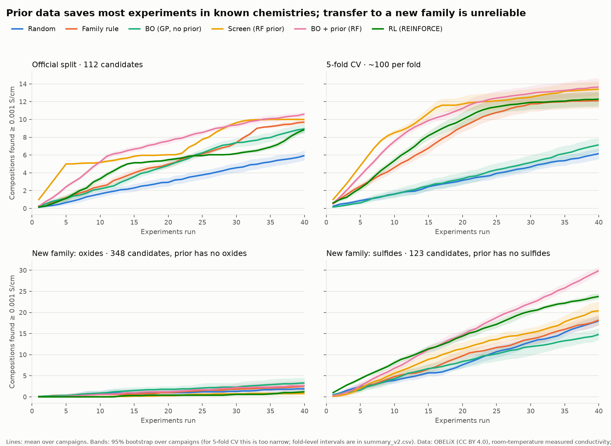

# 固态电池模块：找到一个过线的电解质，要做多少次实验？

> 草稿 · 2026-11-21 · 内部。运行记录：`results/battery_20261121T080824Z/`（配置、环境、输入哈希、每次实验活动的选择序列、逐次得分、汇总）。事后补做的按系列分组检验：`results/battery_grouped0.3_20261121T164150Z/` 和 `results/battery_grouped1_20261121T164402Z/`。

## 商业问题

一个预测具有高离子电导率的材料，距离电池厂愿意测试还有多远？本模块先回答其中可以量化的一段：**在实验室预算有限时，哪种选择策略能用最少的实验找到电导率过线的材料？先验数据、闭环学习和强化学习各值多少次实验？**

实验次数直接对应实验室预算，所以这个结果可以直接用于资源决策。

## 设计（运行前写入 `results/<run_id>/config.json`）

**数据。** [OBELiX](https://github.com/NRC-Mila/OBELiX)（Therrien et al. 2025, arXiv:2502.14234，CC BY 4.0），固定在 commit `4eaac88`。数据集有 599 条已合成的锂固态电解质，给出室温总离子电导率。同一组成的多次测量取 log10 中位数，合并后得到 499 个组成。

**离线实验室。** 对一个组成"做一次实验"，就是读出它在 OBELiX 里的实测电导率。

**门槛。** 主门槛定为 10⁻³ S/cm，在运行前定下。**它是本研究自定的筛选阈值，不是已证实的电池厂采购或测试标准**，下文说"过线"都指过这个研究阈值。敏感度检验用 10⁻⁴（只在官方划分上做）和 10⁻²（在 5 折上做）。
- 10⁻⁴ 太容易：全数据里 42.5% 的组成都能过线。
- 10⁻³ 这个数字有没有买家侧出处**还没查到**，是待补项；在找到之前，不能写成"电池厂愿意测试的门槛"。两条线索：Randau et al. 2020 的全固态电池基准研究提出了量化研究目标；Bielefeld、Weber 和 Janek 2020 指出高负载电极需要 10 mS/cm 以上，正好对应 10⁻² 的敏感度门槛。两篇都还没读原文。

**特征。** 只用化学组成，共 38 个特征：锂含量、元素性质（电负性、原子半径、原子质量、周期、族）的加权统计，以及骨架和阴离子元素的含量。只用组成，是因为 278 条没有对应的晶体结构。所有策略看到的特征完全相同。

**预算。** 每次实验活动 40 次实验。

**三种划分方式：**

| 划分 | 先验数据 | 候选池 | 检验什么 |
|---|---|---|---|
| official | OBELiX 官方训练集（387 个组成） | 官方测试集（112 个组成，其中 16 个过 10⁻³） | 数据集作者设计的划分 |
| cv5 | 其余 4 折 | 留出的一折（约 100 个） | 结果对划分方式是否稳定 |
| family_oxide / family_sulfide | 其他所有化学家族 | 整个氧化物家族（348 个，17 个过线）或硫化物家族（123 个，55 个过线） | 实验室转向一个新化学体系时，先验数据还有没有用 |

化学家族在运行前定义：含 O 为氧化物；否则含 S 或 Se 为硫化物；否则含卤素为卤化物；其余为"其他"。

**六种选择策略：**

| 策略 | 用先验数据 | 闭环学习 | 是什么 |
|---|---|---|---|
| random | 否 | 否 | 随机挑。每个实验室都有的基线 |
| family_rule | 只用家族命中率 | 否 | 化学家的经验法则：先测先验数据里命中率高的家族，家族内随机。不用机器学习 |
| bo_gp | 否 | 是 | 贝叶斯优化：高斯过程，5 次随机起步，然后按期望改进选 |
| screen_rf | 是 | 否 | 计算筛选：随机森林在先验数据上训练一次，按预测值从高到低做 |
| bo_rf_prior | 是 | 是 | 先验数据加闭环：每做完一次实验，用先验数据加本次活动的结果重训随机森林，按置信上界选 |
| rl_reinforce | 是（用于训练） | 是（状态里包含已有发现） | 强化学习：REINFORCE，线性 softmax 策略，在先验数据中抽出的 1,500 个模拟实验活动上训练，再在候选池上运行 |

**指标。** 第一个命中需要的实验次数；找到 5 个命中需要的实验次数；第 10、20、40 次实验时的累计命中数。40 次内没达到的，记为 41（截尾）。

截尾的实验活动**不能**读成"用了 41 次"：它只说明 40 次不够，真实需要多少次不知道。所以凡是有截尾的地方，同时报三样：40 次内成功的比例、成功活动的平均次数、预算内的命中数（前 10 次、前 40 次）。比较方法时以预算内命中数为主，"找到 5 个的次数"只在两边都没有截尾时直接比。

**置信区间。** 95% 百分位 bootstrap，2,000 次重抽。cv5 按折做整群重抽，其他划分重抽实验活动（见"审查后的修正"）。它**不**反映"文献里恰好报道了哪些材料"带来的不确定性。

## 结果

**一句话：在已知化学体系里，先验实验数据省下的实验次数，远多于选择算法之间的差别；但其中一块来自同一掺杂系列内的插值，把系列整个留出后，收益变小、区间变宽。转到一个新化学家族时，先验模型能不能用取决于方向：迁移到硫化物有效，迁移到氧化物无效，事先不知道是哪一种。**

下面把收益按"候选和先验数据有多像"分三层报，不混在一起：

| 层次 | 划分 | 候选离先验数据多近 | 回答的问题 |
|---|---|---|---|
| 系列内插值 | official、cv5（随机分折） | cv5 每折约一半、official 四分之一的候选，在先验里有同系列近邻（距离 < 0.3） | 已经在做的掺杂系列里，下一个配比先测哪个 |
| 已知家族内的新系列 | cv5 按系列分组（事后补做） | 先验里没有距离 < 0.3（或 < 1.0）的近邻，但家族是见过的 | 在熟悉的化学家族里换一个新骨架 |
| 跨家族迁移 | family_oxide、family_sulfide | 先验里没有这个家族 | 实验室转向一个没做过的化学体系 |



主门槛 10⁻³ S/cm，预算 40 次实验。数字取自 `summary_v2.csv`。方括号里是 95% bootstrap 区间：cv5 先按折重抽、再在折内对种子求平均；其他划分直接重抽实验活动。有截尾的格子写成"带截尾平均（40 次内成功的比例；成功活动的平均）"。带截尾的平均值会**低估**真实需要的次数，成功活动的平均又只看了运气好的那部分，两个数都不是真实期望，只能一起看。

| 划分 | 策略 | 找到 5 个命中需要的实验数（截尾比例） | 前 10 次实验的命中数 | 40 次实验的命中数 |
|---|---|---|---|---|
| official（112 个候选，16 个过线） | 随机 | 30.0 [27.1, 33.1]（成功 77%；成功者 26.7） | 1.6 [1.3, 2.0] | 5.9 [5.3, 6.5] |
| | 化学家族规则 | 17.4 [15.9, 19.0] | 2.5 [2.0, 2.9] | 9.7 [9.4, 10.0] |
| | 贝叶斯优化（无先验） | 18.8 [17.5, 19.9] | 2.2 [1.9, 2.5] | 8.9 [8.4, 9.5] |
| | 计算筛选（先验） | 5.0 | 5.2 [5.0, 5.3] | 10.0 |
| | 先验 + 闭环 | 9.2 [8.9, 9.6] | 5.2 [5.0, 5.5] | 10.6 [10.3, 10.9] |
| | 强化学习 | 12.7 [12.1, 13.3] | 3.3 [3.0, 3.6] | 8.9 [8.6, 9.2] |
| cv5（每折约 100 个，约 15 个过线） | 随机 | 29.5 [25.2, 33.0]（成功 74%；成功者 25.4） | 1.6 [1.0, 2.3] | 6.2 [4.9, 7.6] |
| | 化学家族规则 | 10.8 [8.3, 13.4] | 4.6 [3.5, 5.7] | 12.1 [9.8, 14.7] |
| | 贝叶斯优化（无先验） | 27.2 [19.7, 35.1]（成功 80%；成功者 23.8） | 1.6 [0.7, 2.6] | 7.1 [5.0, 9.3] |
| | 计算筛选（先验） | 5.2 [5.0, 5.6] | 8.5 [7.6, 9.4] | 13.4 [10.8, 16.4] |
| | 先验 + 闭环 | 6.5 [5.7, 7.3] | 7.5 [6.6, 8.4] | 13.6 [11.0, 16.8] |
| | 强化学习 | 9.2 [7.7, 11.4] | 5.4 [4.1, 6.2] | 12.3 [9.8, 14.8] |
| family_oxide（348 个氧化物，17 个过线；先验 151 个，58 个过线） | 随机 | 41（成功 0%） | 0.8 [0.3, 1.4] | 1.9 [1.2, 2.6] |
| | 化学家族规则（只有一个家族，等于随机） | 40.9（成功 10%；成功者 40.0） | 0.6 [0.2, 1.0] | 2.5 [1.6, 3.4] |
| | 贝叶斯优化（无先验） | 39.3（成功 10%；成功者 24.0） | 0.9 [0.4, 1.5] | 3.3 [2.3, 4.6] |
| | 计算筛选（先验） | 41（成功 0%） | 0.0 | 0.8 [0.4, 1.3] |
| | 先验 + 闭环 | 38.9（成功 30%；成功者 34.0） | 0.6 [0.3, 0.9] | 2.6 [1.6, 3.7] |
| | 强化学习 | 41（成功 0%） | 0.0 | 1.2 [0.8, 1.6] |
| family_sulfide（123 个硫化物，55 个过线；先验 376 个，20 个过线） | 随机 | 12.3 [9.9, 14.7] | 3.9 [3.1, 4.7] | 18.0 [17.0, 19.0] |
| | 化学家族规则（只有一个家族，等于随机） | 11.0 [8.8, 13.3] | 4.8 [3.6, 5.9] | 18.2 [16.9, 19.6] |
| | 贝叶斯优化（无先验） | 12.5 [9.3, 17.2] | 4.3 [3.3, 5.2] | 14.8 [13.4, 16.4] |
| | 计算筛选（先验） | 9.7 [8.0, 11.6] | 5.6 [4.3, 6.9] | 20.4 [18.4, 22.6] |
| | 先验 + 闭环 | 7.6 [6.8, 8.3] | 6.8 [6.1, 7.5] | 29.9 [29.1, 30.8] |
| | 强化学习 | 5.9 [5.3, 6.7] | 8.1 [7.4, 8.7] | 23.8 [23.2, 24.5] |

计算筛选和强化学习的区间很窄，是因为每个划分只训练了一次模型：区间只反映随机森林的种子或策略抽样，不反映"换一次训练会怎样"。读的时候不要把 [5.0, 5.0] 当成确定。

随机策略第一个命中的实测平均值和理论值 (N+1)/(K+1) 吻合（official 6.4 对 6.6，cv5 6.7 对 6.5）。这只说明随机抽样的实现是对的，不能说明其他策略或数据没有问题。

### 五个发现

这五条之前都要先读两点："过线"是研究自定的阈值；"省下的实验数"是离线回测里的测量次数，不是实验成本（见"局限"）。

1. **先验数据在已知化学体系里省实验，但"省 25 次"里有一块是系列内插值。** 找到 5 个过线材料，随机要 30 次左右（带截尾，约四分之一的活动 40 次内没找到），用先验测量训练的计算筛选在 official 和随机分折的 cv5 上只要 5 次。把同一系列整个留出后（见下面"插值和泛化分开看"）：
    - 计算筛选变成 12.9 次 [8.0, 17.8]（按距离 0.3 分系列）或 7.6 次 [5.5, 9.7]（按 1.0 分系列），随机仍是 30 次左右且只有 54–72% 的活动成功。先验数据仍然有用，但收益比 25 次小，区间宽得多。
    - 相对"先测硫化物"这条规则，计算筛选多省的次数从 5.6 次（cv5）降到 3–4 次，区间重叠或几乎重叠。也就是说，在新系列上，机器学习比化学家经验多出来的那一部分，主要是系列内插值给的。
    - 两种分系列的方式结果不一致（0.3 的反而更难），说明结果对"哪些系列恰好落进同一折"很敏感：五折的过线数从 6 到 29 不等。
    - 只有这一个数据集，里面全是已发表的材料。
2. **一条不用机器学习的经验法则拿到了相当大一部分收益。** "先测硫化物"把 5 个命中所需的实验数，在 official 上从 30 降到 17.4，约占"随机到最好方法"差距的一半；在 cv5 上从 29.5 降到 10.8，约占 77%。硫化物里 45% 的组成过线，氧化物里只有 5%。所以衡量 AI 的增量价值，基线应该是这条规则，不是随机。相对这条规则，计算筛选还能再省 12 次（official）和 5.6 次（cv5）。
3. **没有先验数据时，贝叶斯优化的效果不稳定。** 在 official 上，它比随机明显好（18.8 次对 30.0 次）；在 cv5 上，按折计算的区间和随机重叠（27.2 [19.7, 35.1] 对 29.5 [25.2, 33.0]），分不出来。为什么不稳定，这次实验没有检验。
4. **迁移到新化学家族，效果取决于方向，而且事先看不出来。**
    - **迁移到氧化物：失效。** 先验是硫化物、卤化物和 9 个"其他"组成。计算筛选在 40 次里只找到 0.8 个，随机找到 1.9 个，区间刚好相接；强化学习 1.2 个。大部分方法 40 次内都没找到 5 个（截尾 70–100%），这里只有 10 次实验活动，证据弱。
    - **迁移到硫化物：有效。** 先验是氧化物、卤化物和其他。先验 + 闭环在 40 次里找到 29.9 个，随机 18.0 个；强化学习找到 5 个只要 5.9 次，随机要 12.3 次。不过这个池子里将近一半都过线，"有效"的门槛本来就低。
    - 为什么会不对称，这次实验没有检验。
5. **强化学习不是一致的赢家。** 在 official 和 cv5 上，它都不如简单的计算筛选和"先验 + 闭环"（official 上找到 5 个需要 12.7 次，筛选只要 5 次）；迁移到氧化物时失效；迁移到硫化物时却是找到前 5 个最快的。而且每个划分只训练了一个强化学习策略，结果对训练种子有多敏感还不知道。这次实验**没有**检验"强化学习需要便宜的检验器"这条主线，只能说在这个样本量下，简单的强化学习策略没有稳定的优势。

### 插值和泛化分开看（事后补做）

这一节是看到主结果之后才设计的，所以单独标为事后分析，不替代运行前登记的结果。

**做法。** 把标准化特征距离小于 0.3 的两个组成连起来，连通的一组算一个"系列"（单链接，近邻的近邻也算同系列），共 290 个系列，最大的 24 个组成。整个系列一起分进 5 折中的一折，大系列先分，每次分给当前最小的折。这样每个候选在先验里都没有距离 < 0.3 的近邻（实测最近 0.31）。同样的做法用 1.0 再跑一次（200 个系列，最大 34 个）。策略、种子数和预算与主实验相同；强化学习这次没有重跑。

| 策略 | cv5 随机分折 | 按系列分组，距离 0.3 | 按系列分组，距离 1.0 |
|---|---|---|---|
| 随机 | 29.5 [25.2, 33.0]（成功 74%） | 30.8 [22.9, 37.4]（成功 54%） | 29.3 [22.8, 35.1]（成功 72%） |
| 化学家族规则 | 10.8 [8.3, 13.4] | 17.2 [8.8, 28.6]（成功 84%） | 11.1 [10.0, 12.2] |
| 贝叶斯优化（无先验） | 27.2 [19.7, 35.1]（成功 80%） | 29.1 [22.0, 36.6]（成功 62%） | 27.7 [19.9, 34.6]（成功 72%） |
| 计算筛选（先验） | 5.2 [5.0, 5.6] | 12.9 [8.0, 17.8] | 7.6 [5.5, 9.7] |
| 先验 + 闭环 | 6.5 [5.7, 7.3] | 13.6 [5.8, 22.0] | 7.7 [6.7, 8.9] |

找到 5 个命中需要的实验数，区间按折做整群 bootstrap。没写成功率的格子是 100%。第一个命中，计算筛选在三种分法下都约为 1 次，所以"先做哪一个"的排序在新系列上依然有效，变差的是连续找到多个。

**读法。** 跨家族迁移的结果见上面 family_oxide / family_sulfide 两行。三层合在一起：系列内插值收益最大也最稳；已知家族里的新系列，先验数据仍有用，但比经验规则多出的部分很小；跨家族，取决于方向。

### 敏感度检验

- **10⁻⁴ S/cm（official）：** 官方测试池里 40% 的组成过线，全数据是 42.5%。找到 5 个命中：计算筛选 5.0 次、先验 + 闭环 5.1 次、强化学习 8.2 次、无先验贝叶斯优化 10.2 次、家族规则 11.0 次、随机 12.5 次。用先验数据的三种方法仍然领先，但差距从约 25 次缩小到约 7 次。
- **10⁻² S/cm（cv5）：** 全数据里只有 6 个组成达到这个门槛，有一折一个都没有。每种方法至少 20% 的实验活动在 40 次内一个都没找到，随机是 52%。第一个命中（带截尾）：先验 + 闭环 12.4 次、计算筛选 14.2 次、强化学习 16.4 次、家族规则 19.1 次、随机 30.1 次，按折计算的区间都很宽（例如计算筛选 [1.2, 30.0]）。只能作为方向参考。

## 这个结果能改变什么决策

> **2026-11-21 更新：** 之后做了一次事先定好退出条件的商业证据关卡（`COMMERCIAL_EVIDENCE_GATE.md`，规则在检索前提交到 git，commit `80f062e`）。买家侧的验收指标找到了：大众的 700 次循环、容量损失不超过 20%（没有测试条件），以及 USABC 的电芯目标；买家点名的材料限制是界面耐久性，不是电导率；没有找到买家侧的电导率门槛，10⁻³ S/cm 仍是研究筛选阈值。按事先定好的规则，下表中"和电池厂谈合作"改为**批准（限定范围）**：只谈联合探索，里程碑按带测试条件的电芯级指标设。下表保留原文。

这一节是推断，依据是一个只包含已发表材料的回测。

| 决策 | 回测给出的依据 | 建议 |
|---|---|---|
| 下一笔钱投在更好的选择算法，还是更多的实测数据？ | 系列内插值时，先验数据省约 25 次；换一个新系列，省 17–22 次但区间宽；有先验时，几种算法之间只差几次 | **在已知家族里优先投数据**：先整理已有的实测电导率数据。是否值得花钱新测先验数据，要先有每次测量的真实成本 |
| AI 的增量价值拿什么比？ | 一条经验法则就拿到一半到四分之三的收益 | 内部汇报 AI 价值时，基线用领域规则，不用随机 |
| 实验室要不要投入强化学习做实验选择？ | 没有稳定的优势，只训练了一个策略 | **暂缓大投入。** 先用多个训练种子重做，看优势在硫化物上是否稳定 |
| 进入一个新的化学家族时，能不能信任现有模型？ | 迁移到硫化物有效，迁移到氧化物无效，事先看不出来 | **不能默认信任。** 在新家族的前几次实验里，同时安排一小组随机或探索性样本，用它们检验模型的排序还对不对，再决定放大预算。这是信息价值高的地方 |
| 和电池厂谈合作时说什么？ | 回测里，同一系列内实验数降到约六分之一，已知家族的新系列降到约四分之一到五分之二；新家族不确定 | 只对已在做的系列和已知家族承诺加速，而且按研究阈值说，不说成电池厂标准；新家族写成联合探索，里程碑按实测结果设定 |

回到商业问题："一个预测具有高离子电导率的材料，距离电池厂愿意测试还有多远？" 本模块只量化了第一段：找到电导率过线的材料要多少次实验。电化学窗口、空气稳定性、界面和电芯级循环，在这个数据集里都没有，需要文献回测和伙伴测试来补。

## 泄漏检查

- **跨官方训练/测试的两个重复组成。** OBELiX 里有两个组成同时出现在官方训练集和测试集，都是 Li–Ge–P–S 体系：`Li80.4Ge8.4P15.6S96.0`（测试，1.54×10⁻³ S/cm）对 `Li20.1Ge2.1P3.9S24.0`（训练，1.22×10⁻² S/cm）；`Li81.6Ge9.6P14.4S96.0`（测试，6.5×10⁻⁴）对 `Li20.4Ge2.4P3.6S24.0`（训练，1.32×10⁻²）。归一化后是同一个组成，两边的测量值差了 8–20 倍。处理方式（运行前写在 `data.py` 里）：整组只放在测试池，训练侧那条不进先验，测得值取两条的 log10 中位数。代码检查：499 个组成的键唯一，先验和候选池的交集为 0。
- **还剩的风险。** 这只排除了"同一组成两边都有"。近似重复（同一系列）没有排除，见上面"插值和泛化分开看"。中位数里用了训练侧那条测量，所以这两个候选的"实测值"有一部分来自官方训练集。模型看不到这条测量，但它会影响这两个候选算不算过线：按中位数两个都过 10⁻³，只用测试侧那条则一个过、一个不过。
- **独立审查不等于证明没有泄漏。** 审查读了代码和数字，上面的检查是直接对数据跑的，两者都只覆盖了列出的那几种泄漏方式。

## 审查后的修正

运行之后请了一个独立的审查。它没有发现数据泄漏或计算错误，所有数字也和 `summary.csv` 一致；但指出了几处说过头的地方，已经按下面这样改了：

- 原来的 cv5 区间把同一折的 10 个种子当成独立样本，区间偏窄。新增 `src/battery/analyze.py` 改用按折的整群 bootstrap，结果写在 `summary_v2.csv`；`config.json` 里"区间反映折间差异"的说法不准确。
- 原来写"迁移到新家族就失效"，但只在氧化物上成立；硫化物的结果相反，现在两者都放进了表和图。
- 原来写"没有先验时贝叶斯优化约等于随机"，只在 cv5 上成立。
- 补上截尾比例；补上掺杂系列近似重复的提醒；"10⁻⁴ 有 45% 过线"改为 42.5%（全数据）和 40%（官方测试池）。
- 第二轮检查（2026-11-21）：门槛改称研究筛选阈值；有截尾的地方补上成功率和成功活动的平均；补了跨划分重复组成的直接检查；把系列内插值、新系列和跨家族迁移分开报（新增 `src/battery/run_grouped.py`，事后分析）；写明离线实验次数不等于实验成本。
- 两个次要的实现细节还没改，留到下一次运行：高斯过程的期望改进用的是含噪声的标准差；强化学习的基线在计算优势之前就用当前回合更新了，有一点偏差。
## 局限

- **回测不是发现。** 候选池里都是已经发表过的材料。
- **文献偏向成功的结果。** 电导率很低的失败材料往往没有发表，所以候选池里的命中比例可能比真实探索时高。
- **只用组成，不用结构。** 加入结构特征后，计算筛选的表现可能更好。
- **强化学习策略很简单**（线性策略，1,500 个训练活动），每个划分只训练了一次。更强的强化学习可能表现更好。所以本实验只能说明"简单的强化学习在这个样本量下怎么样"，不能说明强化学习本身的上限。
- **同一掺杂系列的近似重复。** 官方测试集 25%、随机分折的 cv5 每折约一半的组成，在先验里有标准化特征距离小于 0.3 的近邻。按系列分组的补充检验见上文。
- **离线"实验次数"不是实验成本。** 回测里"做一次实验"只是读出一个已发表的数，所有候选成本相同。真实实验里，合成难度、前驱体、制样和表征时间差别很大（硫化物要在惰性气氛里处理）。先验数据也不是免费的：OBELiX 的 599 条测量是很多实验室多年做出来的，回测把它当成现成的。所以"先验数据省 N 次实验"只能读成"在已有这些数据的前提下"；要比较"花钱获取先验数据"和"花钱做更多实验"，需要两边的真实成本，这里没有。
- **门槛是研究筛选阈值。** 10⁻³ S/cm 不是已证实的电池厂标准。
- **运行记录里没有代码版本。** 项目还不是 git 仓库，`env.json` 没记 commit；建仓库后补上。

## 复现

```bash
cd materials-intelligence
.venv/bin/python -I src/battery/fetch_obelix.py
.venv/bin/python src/battery/run_experiment.py
.venv/bin/python src/battery/analyze.py results/<run_id>
.venv/bin/python src/battery/plot_results.py results/<run_id>
.venv/bin/python src/battery/run_grouped.py 0.3    # 事后分析：按系列分组；再跑一次 1.0
.venv/bin/python src/battery/analyze.py results/<grouped_run_id>
```

---

## English version

**Solid-state battery module: how many experiments does it take to find an electrolyte above threshold?**

> Draft · 2026-11-21 · Internal. Run record: `results/battery_20261121T080824Z/` (config, environment, input hashes, the selection sequence of each campaign, per-experiment scores, summary). Grouped-by-series tests added afterwards: `results/battery_grouped0.3_20261121T164150Z/` and `results/battery_grouped1_20261121T164402Z/`.

### Business question

How far is a material predicted to have high ionic conductivity from being one a battery maker is willing to test? This module first answers the part that can be quantified: **with a limited lab budget, which selection strategy finds a material with conductivity above threshold in the fewest experiments? How many experiments are prior data, closed-loop learning and reinforcement learning each worth?**

The number of experiments maps directly to lab budget, so this result can be used directly for resource decisions.

### Design (written to `results/<run_id>/config.json` before the run)

**Data.** [OBELiX](https://github.com/NRC-Mila/OBELiX) (Therrien et al. 2025, arXiv:2502.14234, CC BY 4.0), pinned at commit `4eaac88`. The dataset has 599 synthesized lithium solid-state electrolytes and gives their total ionic conductivity at room temperature. Multiple measurements of the same composition are merged by taking the log10 median, which gives 499 compositions.

**Offline lab.** "Running one experiment" on a composition means reading its measured conductivity in OBELiX.

**Threshold.** The main threshold is 10⁻³ S/cm, set before the run. **It is a screening threshold set by this study, not a confirmed battery-maker procurement or testing standard.** Below, "above threshold" always means above this research threshold. Sensitivity checks use 10⁻⁴ (only on the official split) and 10⁻² (on the 5 folds).
- 10⁻⁴ is too easy: 42.5% of compositions in the full data pass it.
- A buyer-side source for 10⁻³ **has not been found yet**; this is an open item. Until one is found, it must not be written as "the threshold at which battery makers are willing to test". Two leads: the all-solid-state battery benchmarking study by Randau et al. 2020 proposed quantitative research targets; Bielefeld, Weber and Janek 2020 point out that high-loading electrodes need more than 10 mS/cm, which matches the 10⁻² sensitivity threshold. Neither paper has been read in the original yet.

**Features.** Chemical composition only, 38 features in total: lithium content, weighted statistics of element properties (electronegativity, atomic radius, atomic mass, period, group), and the content of framework and anion elements. Composition only, because 278 entries have no matching crystal structure. All strategies see exactly the same features.

**Budget.** 40 experiments per campaign.

**Three split types:**

| Split | Prior data | Candidate pool | What it tests |
|---|---|---|---|
| official | OBELiX official training set (387 compositions) | Official test set (112 compositions, 16 of them above 10⁻³) | The split designed by the dataset authors |
| cv5 | The other 4 folds | The held-out fold (about 100) | Whether the results are stable across splits |
| family_oxide / family_sulfide | All other chemical families | The whole oxide family (348, 17 above threshold) or sulfide family (123, 55 above threshold) | Whether prior data still helps when a lab moves to a new chemical system |

Chemical families were defined before the run: contains O → oxide; otherwise, contains S or Se → sulfide; otherwise, contains a halogen → halide; the rest are "other".

**Six selection strategies:**

| Strategy | Uses prior data | Closed-loop learning | What it is |
|---|---|---|---|
| random | No | No | Pick at random. The baseline every lab has |
| family_rule | Family hit rates only | No | A chemist's rule of thumb: test families with high hit rates in the prior data first, random within a family. No machine learning |
| bo_gp | No | Yes | Bayesian optimization: Gaussian process, 5 random starts, then pick by expected improvement |
| screen_rf | Yes | No | Computational screening: a random forest trained once on the prior data, tested from highest to lowest prediction |
| bo_rf_prior | Yes | Yes | Prior data plus closed loop: after each experiment, retrain the random forest on the prior data plus this campaign's results, pick by upper confidence bound |
| rl_reinforce | Yes (for training) | Yes (the state includes discoveries so far) | Reinforcement learning: REINFORCE, linear softmax policy, trained on 1,500 simulated campaigns drawn from the prior data, then run on the candidate pool |

**Metrics.** Experiments to the first hit; experiments to find 5 hits; cumulative hits at experiments 10, 20 and 40. A campaign that does not reach the target within 40 is recorded as 41 (censored).

A censored campaign **cannot** be read as "used 41 experiments". It only shows that 40 were not enough; the true number needed is unknown. So wherever there is censoring, three things are reported together: the share that succeeded within 40, the mean count of the successful campaigns, and hits within budget (first 10, first 40). Methods are compared mainly on hits within budget. "Experiments to find 5" is compared directly only when neither side is censored.

**Confidence intervals.** 95% percentile bootstrap, 2,000 resamples. cv5 uses cluster resampling by fold; the other splits resample campaigns (see "Corrections after review"). The intervals do **not** reflect the uncertainty from "which materials happen to be reported in the literature".

### Results

**In one sentence: in a known chemical system, prior experimental data saves far more experiments than the differences between selection algorithms. But part of that comes from interpolation within the same doping series; when whole series are held out, the gain is smaller and the intervals are wider. When moving to a new chemical family, whether the prior model is usable depends on the direction: transfer to sulfides works, transfer to oxides does not, and which one it will be is not known in advance.**

Below, the gains are reported in three layers by "how similar the candidates are to the prior data", not mixed together:

| Layer | Split | How close the candidates are to the prior data | Question answered |
|---|---|---|---|
| Within-series interpolation | official, cv5 (random folds) | About half the candidates in each cv5 fold, and a quarter in official, have a same-series near neighbor in the prior (distance < 0.3) | In a doping series already in progress, which ratio to test next |
| New series within a known family | cv5 grouped by series (added afterwards) | No near neighbor with distance < 0.3 (or < 1.0) in the prior, but the family has been seen | Switching to a new framework in a familiar chemical family |
| Cross-family transfer | family_oxide, family_sulfide | This family is not in the prior | The lab moves to a chemical system it has not worked on |


Main threshold 10⁻³ S/cm, budget 40 experiments. Numbers are from `summary_v2.csv`. Brackets are 95% bootstrap intervals: for cv5, folds are resampled first, then averaged over seeds within each fold; the other splits resample campaigns directly. Cells with censoring are written as "censored mean (share that succeeded within 40; mean of successful campaigns)". The censored mean **underestimates** the true number needed, and the mean of successful campaigns only covers the lucky part. Neither number is the true expectation; read them together.

| Split | Strategy | Experiments to find 5 hits (censored share) | Hits in the first 10 experiments | Hits at 40 experiments |
|---|---|---|---|---|
| official (112 candidates, 16 above threshold) | Random | 30.0 [27.1, 33.1] (77% succeeded; successful mean 26.7) | 1.6 [1.3, 2.0] | 5.9 [5.3, 6.5] |
| | Chemical-family rule | 17.4 [15.9, 19.0] | 2.5 [2.0, 2.9] | 9.7 [9.4, 10.0] |
| | Bayesian optimization (no prior) | 18.8 [17.5, 19.9] | 2.2 [1.9, 2.5] | 8.9 [8.4, 9.5] |
| | Computational screening (prior) | 5.0 | 5.2 [5.0, 5.3] | 10.0 |
| | Prior + closed loop | 9.2 [8.9, 9.6] | 5.2 [5.0, 5.5] | 10.6 [10.3, 10.9] |
| | Reinforcement learning | 12.7 [12.1, 13.3] | 3.3 [3.0, 3.6] | 8.9 [8.6, 9.2] |
| cv5 (about 100 per fold, about 15 above threshold) | Random | 29.5 [25.2, 33.0] (74% succeeded; successful mean 25.4) | 1.6 [1.0, 2.3] | 6.2 [4.9, 7.6] |
| | Chemical-family rule | 10.8 [8.3, 13.4] | 4.6 [3.5, 5.7] | 12.1 [9.8, 14.7] |
| | Bayesian optimization (no prior) | 27.2 [19.7, 35.1] (80% succeeded; successful mean 23.8) | 1.6 [0.7, 2.6] | 7.1 [5.0, 9.3] |
| | Computational screening (prior) | 5.2 [5.0, 5.6] | 8.5 [7.6, 9.4] | 13.4 [10.8, 16.4] |
| | Prior + closed loop | 6.5 [5.7, 7.3] | 7.5 [6.6, 8.4] | 13.6 [11.0, 16.8] |
| | Reinforcement learning | 9.2 [7.7, 11.4] | 5.4 [4.1, 6.2] | 12.3 [9.8, 14.8] |
| family_oxide (348 oxides, 17 above threshold; prior 151, 58 above threshold) | Random | 41 (0% succeeded) | 0.8 [0.3, 1.4] | 1.9 [1.2, 2.6] |
| | Chemical-family rule (only one family, so equal to random) | 40.9 (10% succeeded; successful mean 40.0) | 0.6 [0.2, 1.0] | 2.5 [1.6, 3.4] |
| | Bayesian optimization (no prior) | 39.3 (10% succeeded; successful mean 24.0) | 0.9 [0.4, 1.5] | 3.3 [2.3, 4.6] |
| | Computational screening (prior) | 41 (0% succeeded) | 0.0 | 0.8 [0.4, 1.3] |
| | Prior + closed loop | 38.9 (30% succeeded; successful mean 34.0) | 0.6 [0.3, 0.9] | 2.6 [1.6, 3.7] |
| | Reinforcement learning | 41 (0% succeeded) | 0.0 | 1.2 [0.8, 1.6] |
| family_sulfide (123 sulfides, 55 above threshold; prior 376, 20 above threshold) | Random | 12.3 [9.9, 14.7] | 3.9 [3.1, 4.7] | 18.0 [17.0, 19.0] |
| | Chemical-family rule (only one family, so equal to random) | 11.0 [8.8, 13.3] | 4.8 [3.6, 5.9] | 18.2 [16.9, 19.6] |
| | Bayesian optimization (no prior) | 12.5 [9.3, 17.2] | 4.3 [3.3, 5.2] | 14.8 [13.4, 16.4] |
| | Computational screening (prior) | 9.7 [8.0, 11.6] | 5.6 [4.3, 6.9] | 20.4 [18.4, 22.6] |
| | Prior + closed loop | 7.6 [6.8, 8.3] | 6.8 [6.1, 7.5] | 29.9 [29.1, 30.8] |
| | Reinforcement learning | 5.9 [5.3, 6.7] | 8.1 [7.4, 8.7] | 23.8 [23.2, 24.5] |

The intervals for computational screening and reinforcement learning are narrow because the model was trained only once per split. The intervals only reflect the random forest seed or policy sampling, not "what would happen with another training run". Do not read [5.0, 5.0] as certain.

For random, the measured mean of the first hit matches the theoretical value (N+1)/(K+1) (official 6.4 vs 6.6, cv5 6.7 vs 6.5). This only shows that random sampling is implemented correctly. It does not show that the other strategies or the data are free of problems.

#### Five findings

Before reading any of these five, keep two points in mind: "above threshold" refers to a threshold set by this study; "experiments saved" counts measurements in an offline backtest, not experimental cost (see "Limitations").

1. **Prior data saves experiments in known chemical systems, but part of the "25 saved" is within-series interpolation.** To find 5 materials above threshold, random needs about 30 (censored; about a quarter of campaigns did not find them within 40). Computational screening trained on prior measurements needs only 5 on official and on the randomly split cv5. When whole series are held out (see "Interpolation and generalization, reported separately" below):
    - Computational screening becomes 12.9 [8.0, 17.8] (series defined at distance 0.3) or 7.6 [5.5, 9.7] (series defined at 1.0). Random is still about 30, and only 54–72% of campaigns succeed. Prior data still helps, but the gain is smaller than 25 and the intervals are much wider.
    - Relative to the rule "test sulfides first", the extra saving from computational screening drops from 5.6 (cv5) to 3–4, and the intervals overlap or nearly overlap. That is, on new series, what machine learning adds beyond chemist experience comes mainly from within-series interpolation.
    - The two ways of defining series do not agree (0.3 is actually harder). This shows the result is sensitive to "which series happen to land in the same fold": the number above threshold in the five folds ranges from 6 to 29.
    - There is only this one dataset, and it contains only published materials.
2. **A rule of thumb with no machine learning captures a large share of the gain.** "Test sulfides first" cuts the experiments needed for 5 hits from 30 to 17.4 on official, about half the gap "from random to the best method"; on cv5 it cuts them from 29.5 to 10.8, about 77%. 45% of sulfide compositions are above threshold, against only 5% of oxides. So the baseline for measuring the incremental value of AI should be this rule, not random. Relative to this rule, computational screening saves another 12 (official) and 5.6 (cv5).
3. **Without prior data, Bayesian optimization is not stable.** On official it is clearly better than random (18.8 vs 30.0). On cv5, the by-fold interval overlaps with random (27.2 [19.7, 35.1] vs 29.5 [25.2, 33.0]), and the two cannot be told apart. Why it is unstable was not tested in this experiment.
4. **Transfer to a new chemical family depends on the direction, and this cannot be seen in advance.**
    - **Transfer to oxides: fails.** The prior is sulfides, halides and 9 "other" compositions. Computational screening finds only 0.8 in 40 experiments, random finds 1.9, and the intervals just touch; reinforcement learning finds 1.2. Most methods did not find 5 within 40 (70–100% censored). There are only 10 campaigns here, so the evidence is weak.
    - **Transfer to sulfides: works.** The prior is oxides, halides and other. Prior + closed loop finds 29.9 in 40 experiments, random 18.0. Reinforcement learning needs only 5.9 to find 5, random 12.3. But nearly half of this pool is above threshold, so the bar for "works" is low to begin with.
    - Why the two directions differ was not tested in this experiment.
5. **Reinforcement learning is not a consistent winner.** On official and cv5 it is worse than simple computational screening and "prior + closed loop" (on official it needs 12.7 to find 5, screening only 5). It fails when transferring to oxides, yet when transferring to sulfides it is the fastest to find the first 5. Also, only one reinforcement learning policy was trained per split, and how sensitive the results are to the training seed is not known. This experiment did **not** test the main thesis that "reinforcement learning needs a cheap verifier". It can only say that at this sample size, a simple reinforcement learning policy has no stable advantage.

#### Interpolation and generalization, reported separately (added afterwards)

This section was designed after seeing the main results, so it is marked separately as post-hoc analysis and does not replace the results registered before the run.

**Method.** Any two compositions with a standardized feature distance below 0.3 are linked; each connected group counts as one "series" (single linkage: a neighbor's neighbor is also in the same series). This gives 290 series, the largest with 24 compositions. Each whole series goes into one of the 5 folds; large series are assigned first, each time to the fold that is currently smallest. As a result, no candidate has a neighbor with distance < 0.3 in the prior (the measured nearest is 0.31). The same procedure was run again at 1.0 (200 series, the largest with 34). Strategies, number of seeds and budget are the same as in the main experiment; reinforcement learning was not rerun this time.

| Strategy | cv5 random folds | Grouped by series, distance 0.3 | Grouped by series, distance 1.0 |
|---|---|---|---|
| Random | 29.5 [25.2, 33.0] (74% succeeded) | 30.8 [22.9, 37.4] (54% succeeded) | 29.3 [22.8, 35.1] (72% succeeded) |
| Chemical-family rule | 10.8 [8.3, 13.4] | 17.2 [8.8, 28.6] (84% succeeded) | 11.1 [10.0, 12.2] |
| Bayesian optimization (no prior) | 27.2 [19.7, 35.1] (80% succeeded) | 29.1 [22.0, 36.6] (62% succeeded) | 27.7 [19.9, 34.6] (72% succeeded) |
| Computational screening (prior) | 5.2 [5.0, 5.6] | 12.9 [8.0, 17.8] | 7.6 [5.5, 9.7] |
| Prior + closed loop | 6.5 [5.7, 7.3] | 13.6 [5.8, 22.0] | 7.7 [6.7, 8.9] |

Values are experiments needed to find 5 hits; intervals are cluster bootstrap by fold. Cells without a success rate are 100%. For the first hit, computational screening needs about 1 experiment under all three splits, so the ranking for "which one to test first" still works on new series. What gets worse is finding several in a row.

**How to read it.** For cross-family transfer, see the family_oxide / family_sulfide rows above. Taking the three layers together: within-series interpolation gives the largest and most stable gain; for new series in a known family, prior data still helps, but its margin over the rule of thumb is small; across families, it depends on the direction.

#### Sensitivity checks

- **10⁻⁴ S/cm (official):** 40% of compositions in the official test pool are above threshold, 42.5% in the full data. To find 5 hits: computational screening 5.0, prior + closed loop 5.1, reinforcement learning 8.2, Bayesian optimization without prior 10.2, family rule 11.0, random 12.5. The three methods that use prior data still lead, but the gap shrinks from about 25 to about 7.
- **10⁻² S/cm (cv5):** only 6 compositions in the full data reach this threshold, and one fold has none. For every method, at least 20% of campaigns found none within 40; for random it is 52%. First hit (censored): prior + closed loop 12.4, computational screening 14.2, reinforcement learning 16.4, family rule 19.1, random 30.1. The by-fold intervals are all wide (for example, computational screening [1.2, 30.0]). Use this only as a directional reference.

### What decisions this result can change

> **Update, 21 November 2026:** a commercial evidence gate with exit conditions set in advance was run afterwards (`COMMERCIAL_EVIDENCE_GATE.md`; rules committed to git before any search, commit `80f062e`). Buyer-side acceptance metrics were found: Volkswagen's 700 cycles with at most 20% capacity loss (no test conditions) and USABC's cell targets; the material limit buyers name is interface durability, not conductivity; no buyer-side conductivity threshold was found, so 10⁻³ S/cm remains a research screening threshold. Under the pre-set rules, "partnership talks with a battery maker" in the table below moves to **approve (limited scope)**: joint exploration only, with milestones on cell-level metrics with stated test conditions. The table below keeps its original text.

This section is inference, based on a backtest that contains only published materials.

| Decision | Evidence from the backtest | Recommendation |
|---|---|---|
| Should the next money go to a better selection algorithm or to more measured data? | For within-series interpolation, prior data saves about 25 experiments; for a new series, it saves 17–22 but with wide intervals; with prior data, the algorithms differ by only a few experiments | **Within known families, invest in data first**: start by curating existing measured conductivity data. Whether it is worth paying to measure new prior data depends on first knowing the real cost of each measurement |
| What should the incremental value of AI be compared against? | A single rule of thumb captures half to three quarters of the gain | When reporting AI value internally, use the domain rule as the baseline, not random |
| Should the lab invest in reinforcement learning for experiment selection? | No stable advantage, and only one policy was trained | **Hold off on a large investment.** First redo it with several training seeds and see whether the advantage on sulfides is stable |
| When entering a new chemical family, can the existing model be trusted? | Transfer to sulfides works, transfer to oxides does not, and this cannot be seen in advance | **Do not trust it by default.** In the first few experiments in a new family, also schedule a small set of random or exploratory samples. Use them to check whether the model's ranking still holds, then decide whether to scale up the budget. This is where the value of information is high |
| What to say when discussing a partnership with a battery maker? | In the backtest, the number of experiments drops to about one sixth within the same series, and to about one quarter to two fifths for new series in known families; new families are uncertain | Commit to acceleration only for series already in progress and for known families, and state it against the research threshold, not as a battery-maker standard. Frame new families as joint exploration, with milestones set by measured results |

Back to the business question: "How far is a material predicted to have high ionic conductivity from being one a battery maker is willing to test?" This module quantifies only the first part: how many experiments it takes to find a material with conductivity above threshold. Electrochemical window, air stability, interfaces and cell-level cycling are not in this dataset. They need literature backtests and partner testing to fill in.

### Leakage checks

- **Two duplicate compositions across the official train/test split.** Two compositions in OBELiX appear in both the official training set and the test set, both in the Li–Ge–P–S system: `Li80.4Ge8.4P15.6S96.0` (test, 1.54×10⁻³ S/cm) vs `Li20.1Ge2.1P3.9S24.0` (train, 1.22×10⁻² S/cm); `Li81.6Ge9.6P14.4S96.0` (test, 6.5×10⁻⁴) vs `Li20.4Ge2.4P3.6S24.0` (train, 1.32×10⁻²). After normalization each pair is the same composition, and the measured values on the two sides differ by a factor of 8–20. Handling (written in `data.py` before the run): the whole group goes only into the test pool, the training-side entry does not enter the prior, and the measured value is the log10 median of the two entries. Code checks: the keys of the 499 compositions are unique, and the intersection of the prior and the candidate pool is 0.
- **Remaining risk.** This only rules out "the same composition on both sides". Near duplicates (same series) are not ruled out; see "Interpolation and generalization, reported separately" above. The median uses the training-side measurement, so the "measured value" of these two candidates comes partly from the official training set. The model cannot see this measurement, but it affects whether these two candidates count as above threshold: by the median, both pass 10⁻³; using only the test-side entry, one passes and one does not.
- **An independent review is not proof that there is no leakage.** The review read the code and the numbers; the checks above were run directly on the data. Both cover only the leakage paths listed.

### Corrections after review

After the run, an independent review was requested. It found no data leakage or calculation errors, and all numbers matched `summary.csv`. But it pointed out several overstatements, which have been changed as follows:

- The original cv5 intervals treated the 10 seeds within the same fold as independent samples, so the intervals were too narrow. The new `src/battery/analyze.py` uses cluster bootstrap by fold instead, and writes the results to `summary_v2.csv`. The statement in `config.json` that "the intervals reflect between-fold differences" is not accurate.
- The original text said "transfer to a new family fails", but this holds only for oxides. The sulfide result is the opposite; both are now in the table and the figure.
- The original text said "without prior data, Bayesian optimization is about the same as random", which holds only on cv5.
- Added the censored shares; added the reminder about near duplicates in doping series; changed "45% above threshold at 10⁻⁴" to 42.5% (full data) and 40% (official test pool).
- Second round of checks (2026-11-21): renamed the threshold as a research screening threshold; added success rates and means of successful campaigns wherever there is censoring; added a direct check for duplicate compositions across splits; reported within-series interpolation, new series and cross-family transfer separately (new `src/battery/run_grouped.py`, post-hoc analysis); stated that offline experiment counts are not experimental cost.
- Two minor implementation details have not been changed yet and are left for the next run: the Gaussian process expected improvement uses a standard deviation that includes noise; the reinforcement learning baseline is updated with the current episode before the advantage is computed, which adds a small bias.

### Limitations

- **A backtest is not discovery.** The candidate pool contains only materials that have already been published.
- **The literature is biased toward successful results.** Failed materials with very low conductivity often go unpublished, so the hit rate in the candidate pool may be higher than in real exploration.
- **Composition only, no structure.** With structural features added, computational screening might perform better.
- **The reinforcement learning policy is simple** (linear policy, 1,500 training campaigns), and it was trained only once per split. Stronger reinforcement learning might perform better. So this experiment can only show "how simple reinforcement learning does at this sample size", not the upper limit of reinforcement learning itself.
- **Near duplicates within the same doping series.** 25% of the official test set, and about half of the compositions in each fold of the randomly split cv5, have a near neighbor in the prior with a standardized feature distance below 0.3. The supplementary check grouped by series is above.
- **Offline "experiment counts" are not experimental cost.** In the backtest, "running one experiment" only reads out a published number, and every candidate costs the same. In real experiments, synthesis difficulty, precursors, sample preparation and characterization time vary a lot (sulfides must be handled in an inert atmosphere). Prior data is not free either: the 599 measurements in OBELiX were produced by many labs over many years, and the backtest treats them as already available. So "prior data saves N experiments" can only be read as "given that these data already exist". Comparing "paying to acquire prior data" with "paying for more experiments" needs the real costs of both, which are not available here.
- **The threshold is a research screening threshold.** 10⁻³ S/cm is not a confirmed battery-maker standard.
- **The run record has no code version.** The project is not a git repository yet, and `env.json` does not record a commit; add it once the repository is set up.

### Reproduction

```bash
cd materials-intelligence
.venv/bin/python -I src/battery/fetch_obelix.py
.venv/bin/python src/battery/run_experiment.py
.venv/bin/python src/battery/analyze.py results/<run_id>
.venv/bin/python src/battery/plot_results.py results/<run_id>
.venv/bin/python src/battery/run_grouped.py 0.3    # post-hoc analysis: grouped by series; run again with 1.0
.venv/bin/python src/battery/analyze.py results/<grouped_run_id>
```
