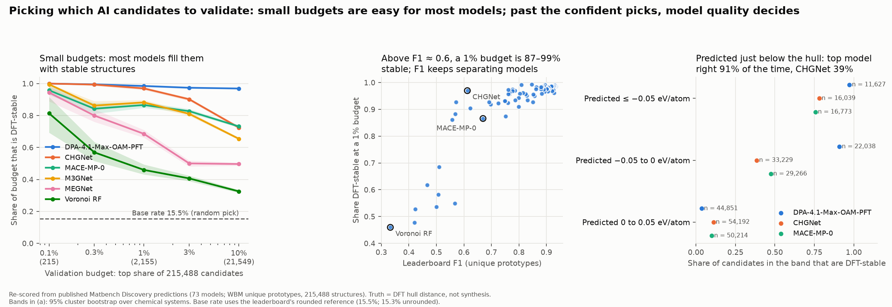

# 稳定性筛选与 CSP 模块：AI 生成了大量晶体结构，哪些值得花钱验证？

> 草稿 · 2026-11-21 · 内部。运行记录：`results/csp_screening_20261121T192919Z/`（配置、来历记录、和排行榜的比对、逐模型指标、预算曲线、边界分析、图）。第一次运行在审查后作废，见"审查后的修正"。
>
> 本模块分两部分：D2A 稳定性筛选（输入是已有候选结构，问是否稳定）；D2B 晶体结构预测的可信度（输入是化学组成，问原子怎么排）。两者不能混为一谈：一个好的稳定性分类器，不说明生成模型能预测未知结构。

## 商业问题

AI 能一次产出几十万个候选晶体结构，但每验证一个都要花钱：先是 DFT 计算，然后是合成和测量。本模块回答其中可以量化的一段：**给定一笔验证预算，按模型预测挑出来的结构，有多少真的稳定？排行榜上的指标，能不能告诉我们该用哪个模型、预算该怎么定？**

## D2A：稳定性筛选

### 用的评测和复现层级

**评测。** [Matbench Discovery](https://github.com/janosh/matbench-discovery)（MIT 许可），固定在 commit `6d587c1`，和散热模块同一个版本。测试集是 WBM：256,963 个结构，由 Materials Project（MP）的结构做元素替换、再用 DFT 弛豫得到。去掉和 MP 原型重复的之后，剩 215,488 个"唯一原型"。**"稳定"的判据是 DFT 算出的凸包距离 ≤ 0，是计算参考，不是合成或实测。**

稳定比例（基础比例）按排行榜的分类惯例（参考值先四舍五入到三位小数）是 15.5%；不四舍五入是 15.3%，因为有 431 个结构在凸包上方不到 0.0005 eV/atom，四舍五入后算成稳定。下文的预算精度都沿用排行榜惯例。

**复现层级：重新计分。** 下载全部 73 个模型公开的形成能预测（按仓库登记的 md5 校验），按官方规则**自己重写**计分代码（`src/csp/discovery_metrics.py`），再和排行榜比对。没有重新跑任何结构弛豫。

**运行前登记的设计**（`config.json` 的 `pre_registered` 部分，第一次运行读预测文件之前写入，这次原样保留）：
- **决策设定。** 把 215,488 个唯一原型当作候选池；验证预算是 K 个结构，按预测凸包距离从低到高挑。K 取候选池的 0.1%、0.3%、1%、3%、10%（215 到 21,549 个），主预算 1%（2,155 个）。预算里真正稳定的比例，下称"预算精度"。
- **三个假设，不预设方向：**
    - H1：按 F1 给模型排名，和按 1% 预算精度排名，结果不同（Spearman < 0.9）。
    - H2：预算从 10% 收紧到 0.1% 时，预算精度是一直上升、持平还是下降。"下降"（类似古德哈特效应）定义为 0.1% 低于 1%，且差值的区间整体小于 0。
    - H3：结构类型在 2023 年 MP 快照里少见或没有的候选，精确率和召回率更低。
- **边界切分：** 是否含锂；结构类型新颖度；真实凸包距离是否在 0.05 eV/atom 以内。

**事后加的分析**（`config.json` 的 `post_hoc_additions`，审查后加入）：
- 结构类型改用不受元素顺序影响的标签，并加一个用**弛豫前**结构判断的版本（筛选时就知道）。
- 按**预测**凸包距离分档，看每个模型 1% 预算挑到哪一档，以及挑错的那些离凸包多远。
- 区间改成按化学体系的整群 bootstrap（WBM 的结构成族出现，彼此相关），500 次重抽。
- 每个模型 1% 预算里浪费的比例。
- F1 较好的那一半模型里的排名相关，作为探索性分析。

### 结果

**一句话：预算小时，几乎所有现代模型挑出来的都是它们最有把握的候选，绝大多数是 DFT 稳定的；预算一旦超出这些有把握的候选，进入"预测刚好在凸包下方"的区域，模型之间的差别就变得很大。在这个测试集里，看不出"挑得越狠越不准"；模型对新结构类型的弱点，主要出现在弛豫后才变成新类型的结构上。**



#### 1. 重新计分和排行榜一致

73 个模型、两个测试子集，一共 146 组指标全部一致：真阳性、假阳性、真阴性、假阴性四个计数逐个相同，比例和误差的差值不超过四舍五入（`leaderboard_check.csv`）。审查代理把官方计分函数和本模块的实现放在一起，在全部 73 个模型的每个结构上比较预测凸包距离，结果完全相同；这份检查保存在 `tests/check_csp_official_port.py`。

#### 2. 小预算：大多数模型都挑得准，但浪费的比例仍差几倍

| 预算（候选池的比例） | 结果 |
|---|---|
| 0.1%（215 个） | 54 / 73 个模型的预算精度 ≥ 0.99 |
| 1%（2,155 个） | 31 个 ≥ 0.97（按三位小数四舍五入是 33 个），48 个 ≥ 0.95；F1 ≥ 0.6 的 62 个模型里最低也有 0.87 |

- 随机挑只有 15.5% 稳定。
- **浪费的比例仍差几倍。** 1% 预算里挑错的比例：F1 第一的模型 1.5%，CHGNet 3.0%（F1 排第 62），MACE-MP-0 13.4%（F1 排第 60）。也就是说，同样 2,155 次验证，MACE-MP-0 会浪费约 290 次，最好的模型约 32 次。
- **H1 成立。** 全部模型里，F1 排名和 1% 预算精度排名的 Spearman 相关是 0.81 [0.77, 0.84]，低于登记的 0.9。探索性地只看 F1 较好的一半（37 个），相关是 0.35 [0.27, 0.45]；这里一部分原因是这一半的预算精度挤在 0.93–0.99 的窄区间里，排名本身就不稳定。区间只对这 73 个模型成立，其中有不少是同一家族的变体。
- 例子：CHGNet 的 F1 是 0.61，1% 预算精度 0.970；F1 排第 18 的 ORB v3 是 0.968。

#### 3. 预算一旦超出"有把握"的候选，模型质量就起决定作用

`predicted_bands.csv` 按模型自己的预测凸包距离分档：

| 预测凸包距离（eV/atom） | F1 前 10 名：这一档里真正稳定的比例 | CHGNet | MACE-MP-0 |
|---|---|---|---|
| ≤ −0.05（有把握是稳定的） | 0.97 | 0.78 | 0.76 |
| −0.05 到 0（刚好在凸包下方） | 0.90–0.93 | 0.39 | 0.47 |
| 0 到 0.05（刚好在凸包上方） | 0.04–0.05 | 0.11 | 0.10 |

- **所有展示的模型，1% 预算都只挑到了"有把握"的那一档。** 前 10 名的这一档约有 11,500 个候选（候选池的 5%），所以预算在 5% 以内时，挑的都是模型最有把握的结构。
- **超出这一档，模型之间差别很大。** "刚好在凸包下方"的候选，前列模型仍有约 90% 是对的，CHGNet 只有 39%，MACE-MP-0 47%。所以预算越大，排行榜上 F1 的差距越接近真实的验证成本差距。
- **挑错的那些不是"差一点"。** 前 10 名 1% 预算里挑错的 22–84 个结构，真实凸包距离的中位数是 0.12–0.27 eV/atom，只有 2–10% 在 0.025 以内（`misses.csv`）。这些是模型很有把握但错得很远的预测，数量少，原因这次没有查。
- 原登记的"真实凸包距离 0.05 以内"这一切分，用的是验证之后才知道的答案，不能指导挑选；结果保留在 `boundary_intervals.csv`，不作为结论。

#### 4. 没有看到"挑得越狠越不准"

**H2：没有下降。** 展示的 17 个模型里，16 个 0.1% 预算精度显著高于 1%，1 个（TACE-OAM-RRA-Preview）分不出来，没有一个显著下降（`topk_curves.csv`）。

**这个检验的范围有限：** 它是在一个固定的候选池里按预测能量排序，候选池来自对已知结构做元素替换。它没有检验一个生成模型对着势函数去优化、走到训练分布之外时会怎样，所以不能拿来说明"用势函数当奖励去优化生成器是安全的"。

#### 5. 结构类型新颖度：差距主要来自弛豫后才变成新类型的结构

| 新颖度的定义 | 何时能知道 | "新类型"候选数 | 稳定比例（新 / 常见） | F1 前 10 名召回率的差距 |
|---|---|---|---|---|
| 弛豫后结构的原始标签（登记的定义） | 验证之后 | 23,703 | 14.3% / 15.0% | −2.4 到 −3.8 个百分点，10 个都显著 |
| 弛豫后结构，不受元素顺序影响的标签 | 验证之后 | 7,829 | 9.6% / 15.5% | −6.1 到 −9.3 个百分点，10 个都显著 |
| 弛豫前结构，不受元素顺序影响的标签 | 筛选时 | 4,255 | 13.5% / 15.3% | −1.3 到 −4.1 个百分点，7 个显著 |

"新类型"指这种结构类型在 2023 年 MP 快照里一个都没有。数字来自 `boundary_intervals.csv`，区间按化学体系做整群 bootstrap。

- **H3 在登记的定义下成立。** 改用不受元素顺序影响的标签后（原始标签会把同一种结构类型因为元素字母顺序不同而算成两种），差距变大。
- **但按筛选时就知道的信息判断，差距小得多。** 用弛豫前的结构判断"新类型"，只有 4,255 个，前 10 名的召回率差距是 1–4 个百分点。大的差距来自弛豫中改变了结构类型的那些候选：7,829 个"弛豫后新类型"里，4,687 个在弛豫中改变了标签，4,262 个弛豫前的结构类型在 MP 里本来就有（`novelty_reference.json`）。
- **小预算挑新类型仍然可行，但样本很小。** 按弛豫前定义，1% 预算只有 43 个结构，F1 前 10 名里 9 个和 CHGNet 全对，另一个是 0.977。
- "MP 2023 快照"是这个评测的参考库，不等于每个模型的训练集（很多较新的模型还用了 OMat24、Alexandria 等数据）。所以"新类型"不能读成"模型没见过的结构类型"。
- 老一代模型（CHGNet、M3GNet、MACE-MP-0）在两个修正后的定义下，召回率没有一致的下降。
- 含锂和不含锂的稳定比例几乎相同（15.6% 对 15.5%），前列模型指标差别很小，不单独展开（`boundaries.csv`）。

## D2B：晶体结构预测的可信度（文献审计）

这一部分不跑实验，审计一篇基准论文和一篇综述。数字都已对照论文原文。

- **论文。** Wei et al., *Deep Generative Crystal Structure Prediction: A Benchmark Study and a Controlled Test of Prototype Dependence*，[arXiv:2609.26502](https://arxiv.org/abs/2609.26502)（v2，2026-10-17）。综述 Hu et al., [arXiv:2610.22600](https://arxiv.org/abs/2610.22600) 给出的数字（TCSP 2.0 为 68.3%，EquiCSP 为 66.4%）和 v1 一致，所以推断它引用的是 v1。
- **利益相关。** 两篇的通讯作者都是南卡罗来纳大学的 Jianjun Hu。作为基线、并在比较中领先的模板方法 TCSPv3，是同一实验室的软件。这不说明结论有误，但读的时候要知道。
- **v2 证明了什么。**
    - 在 180 个目标上，模板方法 TCSPv3 的 top-1 和 top-20 成功率是 67.8% 和 90.6%，最好的生成模型 CrystalFlow 是 63.9% 和 72.2%。
    - 移除某一类化学计量的训练数据后，原先能找回的目标最多丢 48%（EquiCSP 移除 ABC₂：10/21，分母是原先找回的目标；如果以这一类全部目标为分母，是 10/24 = 42%）。AB 只丢 1 个，ABC₂D₆ 一个没丢。
    - 去掉所有钙钛矿框架后重训 EquiCSP，它对 1:1:2:6 目标的一致恢复从 11 个里的 8 个降到 3 个。论文认为这和"模型依赖训练集里的母模板"一致。
- **还没证明什么。**
    - 没有同等规模的随机移除对照（ABC₂ 移除 4,026 个训练结构，AB 只移除 1,038 个）。
    - 每组只重训一次。
    - 框架层面的移除只做了钙钛矿一个家族、一个模型。
    - 没有在训练集之外的独立数据库上检验。
- **结论。** 现有证据支持"在当前基准上，生成模型没有超过模板方法"，不支持"生成模型不能产生新结构"。决定这个结论站不站得住的，是随机移除对照和多种子重训，计算花费都不大。

**和 D2A 合起来看。** D2A 的候选来自对已知结构做元素替换，按筛选时的信息判断，新结构类型只占 2%；D2B 说明在真正要预测新结构时，生成模型还没有超过模板。所以"AI 能发现新结构"这个卖点，目前缺的是**离已知原型更远**的测试证据，而不是更高的排行榜分数。

## 这个结果能改变什么决策

这一节是推断，依据是一个计算评测（真值是 DFT、候选来自元素替换）和两篇论文。

| 决策 | 依据 | 建议（推断） |
|---|---|---|
| 挑验证对象时，要不要换排行榜分数更高的模型？ | 预算在候选池 5% 以内时，挑的都是模型最有把握的候选，F1 前 10 名和 CHGNet 都在 0.96 以上；但浪费比例仍差几倍（1.5% 对 3.0% 对 13.4%） | **先按预算大小决定。** 预算小、每次验证不贵时，换模型的收益有限；预算大，或每次验证很贵（例如直接去合成）时，前列模型能省下的验证次数是实打实的 |
| 预算要不要超出模型"有把握"的那一档？ | 超出之后，前列模型约 90% 对，老模型 39–47% | 如果要超出，**只用前列模型**；老模型在这一档接近抛硬币 |
| "AI 发现新结构"的说法能信到哪一步？ | 按筛选时的信息，新结构类型只占 2%，召回率差距 1–4 个百分点；CSP 基准上生成模型没超过模板 | **不能凭排行榜分数下结论。** 信息价值高的下一步：一个离已知原型更远的测试集，以及 CSP 论文缺的随机移除对照 |
| 用势函数能量当奖励去优化生成器，会不会钻空子？ | 本模块只检验了在固定候选池里排序，没有检验优化生成器 | **本模块不能回答。** 需要单独设计一个对生成器做优化的实验 |
| 下一笔钱投在计算还是实验？ | DFT 稳定只是第 2–3 道关卡；能不能合成，计算回答不了 | 假设（未检验）：在已知原型附近，计算筛选已经够用，下一笔钱更可能在合成和结构确认上产生新信息，这需要实验能力或伙伴 |

**跨模块的一个假设（未检验）。** 三个模块出现了相似的形状：在容易的部分，模型已经和计算参考值对得很好（电池的同系列插值、散热的简单二元化合物、这里的小预算筛选）；剩下的差距在边缘——新化学家族、弛豫后的新结构类型、预测刚好在凸包附近的候选、计算参考和实验之间。这是要在看板和备忘录里检验的假设，不是结论。

## 审查后的修正

运行后请独立代理审查。它确认了：计分实现和官方逐结构一致，报告里的数字都能重算出来，平局处理和缺失值处理正确，结构类型标签全部能解析。它指出的问题和处理：

- **必须改的三处：**
    - 原报告说"离凸包很近的候选是预算失手的地方"，但这一组是按**真实** DFT 凸包距离定义的，验证之前不知道，不能指导挑选。改成按**预测**凸包距离分档。结果推翻了原说法：1% 预算从不碰这一档，挑错的那些也不是"差一点"（中位数 0.12–0.27 eV/atom）。
    - 来历记录原来只给 `src/thermal` 的代码算了哈希，现在覆盖 `src` 下所有代码。
    - MANIFEST.json 在第一次运行之后被改写过（补了两个下载项）。现在 `env.json` 直接记录每个输入文件的哈希，并重新运行了一遍。
- **应该改的：**
    - "排行榜指标在小预算下不再重要"说过头了：浪费比例仍差几倍，已改。较好一半的排名相关标为探索性。
    - "模型没见过的结构类型"没有依据（MP 2023 快照不是很多模型的训练集），已删；并补了按弛豫前结构判断的版本。
    - 新颖度定义的修正补全了说明：在登记的定义下 H3 也成立，修正让差距变大。
    - 区间改成按化学体系的整群 bootstrap。
    - 决策表里关于生成器优化、关于"下一笔钱投合成"和跨模块形状的说法，改成"不能回答"或"假设"。
    - D2B 补了框架移除的结果、作者和基线方法的关系、两种分母，以及"综述引用 v1"是推断。
- **次要的：** 补了逐结构对照官方实现的测试；去掉了重复的预算精度函数；基础比例同时给出四舍五入和不四舍五入的值。
- **作废的运行：** `superseded_csp_screening_20261121T190651Z_pre_review`。

## 局限

- **真值是 DFT，不是合成或实测。** "稳定"指相对 MP 凸包的 DFT 能量，不说明能合成。
- **候选池偏近已知结构。** WBM 由元素替换生成；按筛选时的信息判断，新结构类型只占 2%。
- **预算精度把每次验证当成一样贵。** 真实验证成本因体系而异。
- **新颖度用的是 2025 年 MP 文件里的结构类型标签，限定在 2023 年快照的编号上，** 而不是直接从 2023 年快照的结构算出来；标签算法版本可能有差别。
- **区间只对这 73 个模型成立，** 其中不少是同一家族的变体。
- **只到重新计分这一层。** 没有自己跑结构弛豫，也没有检查各模型的训练数据和 WBM 是否有重叠；本模块沿用排行榜的数据规则。
- **D2B 是文献审计，** 没有重训任何生成模型。
- **项目还不是 git 仓库，** 代码用文件哈希标识；"运行前登记"无法用 git 时间戳独立核对。

## 复现

```bash
cd materials-intelligence
.venv/bin/python -I src/csp/fetch_discovery.py      # WBM 汇总、73 个模型的预测、MP 能量和 2023 年 MP 快照（179 MB）；按 md5 校验
.venv/bin/python src/csp/run_screening.py
.venv/bin/python src/csp/analyze_boundaries.py results/<run_id>
.venv/bin/python src/csp/plot_screening.py results/<run_id>
.venv/bin/python tests/check_csp_official_port.py   # 逐结构对照官方实现
```

---

## English version

### Stability screening and CSP module: AI has generated a large number of crystal structures. Which ones are worth paying to validate?

> Draft · 2026-11-21 · Internal. Run record: `results/csp_screening_20261121T192919Z/` (configuration, provenance record, comparison with the leaderboard, per-model metrics, budget curves, boundary analysis, figures). The first run was superseded after review; see "Corrections after review".
>
> This module has two parts. D2A is stability screening: the input is existing candidate structures, and the question is whether they are stable. D2B is the trustworthiness of crystal structure prediction: the input is a chemical composition, and the question is how the atoms are arranged. The two must not be conflated: a good stability classifier does not show that a generative model can predict unknown structures.

### Business question

AI can produce hundreds of thousands of candidate crystal structures at once, but each validation costs money: first a DFT calculation, then synthesis and measurement. This module answers the part of this that can be quantified: **given a validation budget, how many of the structures picked by model predictions are really stable? Can the leaderboard metrics tell us which model to use and how to set the budget?**

### D2A: Stability screening

#### Benchmark and reproduction level

**Benchmark.** [Matbench Discovery](https://github.com/janosh/matbench-discovery) (MIT licence), pinned at commit `6d587c1`, the same version as the thermal module. The test set is WBM: 256,963 structures, made by element substitution on Materials Project (MP) structures followed by DFT relaxation. After removing those that duplicate MP prototypes, 215,488 "unique prototypes" remain. **The criterion for "stable" is a DFT hull distance ≤ 0. This is a computational reference, not synthesis or measurement.**

The stable share (base rate) is 15.5% under the leaderboard's classification convention (reference values are first rounded to three decimal places). Without rounding it is 15.3%, because 431 structures lie less than 0.0005 eV/atom above the hull and count as stable after rounding. All budget precision figures below follow the leaderboard convention.

**Reproduction level: re-score.** We downloaded the public formation energy predictions of all 73 models (checked against the md5 values registered in the repository), **rewrote** the scoring code ourselves following the official rules (`src/csp/discovery_metrics.py`), and then compared the results with the leaderboard. No structure relaxation was rerun.

**Pre-registered design** (the `pre_registered` section of `config.json`, written before the first run read the prediction files, and kept unchanged for this run):
- **Decision setting.** The 215,488 unique prototypes are treated as the candidate pool. The validation budget is K structures, picked from lowest to highest predicted hull distance. K is 0.1%, 0.3%, 1%, 3% and 10% of the candidate pool (215 to 21,549 structures); the main budget is 1% (2,155 structures). The share of the budget that is truly stable is called "budget precision" below.
- **Three hypotheses, with no direction assumed in advance:**
    - H1: Ranking models by F1 and ranking them by 1% budget precision give different results (Spearman < 0.9).
    - H2: When the budget tightens from 10% to 0.1%, budget precision keeps rising, stays flat, or falls. "Falls" (similar to a Goodhart effect) is defined as 0.1% being lower than 1%, with the interval of the difference entirely below 0.
    - H3: Candidates whose structure type is rare or absent in the 2023 MP snapshot have lower precision and recall.
- **Boundary splits:** whether the candidate contains lithium; structure type novelty; whether the true hull distance is within 0.05 eV/atom.

**Post-hoc additions** (`post_hoc_additions` in `config.json`, added after review):
- Structure type now uses a label that does not depend on element order, plus a version judged from the structure **before relaxation** (known at screening time).
- Bins by **predicted** hull distance, to see which bin each model's 1% budget picks from, and how far from the hull the wrong picks are.
- Intervals changed to a cluster bootstrap by chemical system (WBM structures come in families and are correlated with each other), with 500 resamples.
- The wasted share in each model's 1% budget.
- Rank correlation within the better half of models by F1, as an exploratory analysis.

#### Results

**In one sentence: with a small budget, almost all modern models pick the candidates they are most confident about, and the large majority of these are DFT-stable. Once the budget goes beyond these confident candidates and into the region where predictions are "just below the hull", the differences between models become large. In this test set, there is no sign of "the harder you pick, the less accurate you get". The models' weakness on new structure types shows up mainly in structures that become a new type only after relaxation.**


##### 1. The re-score matches the leaderboard

For 73 models and two test subsets, all 146 sets of metrics match: the four counts (true positives, false positives, true negatives, false negatives) are identical one by one, and the differences in ratios and errors are within rounding (`leaderboard_check.csv`). The review agent ran the official scoring function side by side with this module's implementation and compared the predicted hull distance on every structure for all 73 models; the results were identical. This check is saved in `tests/check_csp_official_port.py`.

##### 2. Small budgets: most models pick accurately, but the wasted share still differs several-fold

| Budget (share of the candidate pool) | Result |
|---|---|
| 0.1% (215 structures) | 54 / 73 models have budget precision ≥ 0.99 |
| 1% (2,155 structures) | 31 at ≥ 0.97 (33 when rounded to three decimals), 48 at ≥ 0.95; among the 62 models with F1 ≥ 0.6, even the lowest is 0.87 |

- Random picking gives only 15.5% stable.
- **The wasted share still differs several-fold.** Share of wrong picks in the 1% budget: 1.5% for the top model by F1, 3.0% for CHGNet (62nd by F1), 13.4% for MACE-MP-0 (60th by F1). That is, with the same 2,155 validations, MACE-MP-0 would waste about 290 and the best model about 32.
- **H1 holds.** Across all models, the Spearman correlation between the F1 ranking and the 1% budget precision ranking is 0.81 [0.77, 0.84], below the pre-registered 0.9. As an exploratory check on only the better half by F1 (37 models), the correlation is 0.35 [0.27, 0.45]. Part of the reason here is that this half's budget precision is packed into a narrow 0.93–0.99 range, so the ranking itself is unstable. The intervals hold only for these 73 models, many of which are variants from the same family.
- Example: CHGNet has an F1 of 0.61 and a 1% budget precision of 0.970; ORB v3, 18th by F1, has 0.968.

##### 3. Once the budget goes beyond the "confident" candidates, model quality decides the outcome

`predicted_bands.csv` bins candidates by each model's own predicted hull distance:

| Predicted hull distance (eV/atom) | F1 top 10: share truly stable in this bin | CHGNet | MACE-MP-0 |
|---|---|---|---|
| ≤ −0.05 (confident it is stable) | 0.97 | 0.78 | 0.76 |
| −0.05 to 0 (just below the hull) | 0.90–0.93 | 0.39 | 0.47 |
| 0 to 0.05 (just above the hull) | 0.04–0.05 | 0.11 | 0.10 |

- **For every model shown, the 1% budget picks only from the "confident" bin.** For the top 10, this bin holds about 11,500 candidates (5% of the candidate pool), so with a budget within 5%, every pick is a structure the model is most confident about.
- **Beyond this bin, models differ a lot.** Among "just below the hull" candidates, leading models are still right about 90% of the time; CHGNet only 39%, MACE-MP-0 47%. So the larger the budget, the closer the F1 gaps on the leaderboard come to the real gaps in validation cost.
- **The wrong picks are not "near misses".** For the 22–84 wrong picks in the top 10's 1% budgets, the median true hull distance is 0.12–0.27 eV/atom, and only 2–10% are within 0.025 (`misses.csv`). These are predictions the models were very confident about but that were far off. They are few in number, and this run did not look into the cause.
- The pre-registered split "true hull distance within 0.05" uses an answer known only after validation, so it cannot guide picking. Its results are kept in `boundary_intervals.csv` and are not used as a conclusion.

##### 4. No sign of "the harder you pick, the less accurate you get"

**H2: no fall.** Of the 17 models shown, 16 have a 0.1% budget precision significantly higher than at 1%, 1 (TACE-OAM-RRA-Preview) cannot be distinguished, and none falls significantly (`topk_curves.csv`).

**This test has a limited scope:** it ranks by predicted energy within a fixed candidate pool, and the pool comes from element substitution on known structures. It did not test what happens when a generative model is optimised against an interatomic potential and moves outside the training distribution. So it cannot be used to argue that "optimising a generator with an interatomic potential as the reward is safe".

##### 5. Structure type novelty: the gap comes mainly from structures that become a new type only after relaxation

| Novelty definition | When it is known | "New type" candidates | Stable share (new / common) | Recall gap for the F1 top 10 |
|---|---|---|---|---|
| Raw label of the relaxed structure (pre-registered definition) | After validation | 23,703 | 14.3% / 15.0% | −2.4 to −3.8 percentage points, all 10 significant |
| Relaxed structure, label independent of element order | After validation | 7,829 | 9.6% / 15.5% | −6.1 to −9.3 percentage points, all 10 significant |
| Structure before relaxation, label independent of element order | At screening time | 4,255 | 13.5% / 15.3% | −1.3 to −4.1 percentage points, 7 significant |

"New type" means that not a single structure of this type exists in the 2023 MP snapshot. The numbers come from `boundary_intervals.csv`; intervals use a cluster bootstrap by chemical system.

- **H3 holds under the pre-registered definition.** With the label that does not depend on element order (the raw label counts the same structure type as two types when the alphabetical order of the elements differs), the gap grows.
- **But judged by information known at screening time, the gap is much smaller.** Judging "new type" from the structure before relaxation gives only 4,255 candidates, and the recall gap for the top 10 is 1–4 percentage points. The large gap comes from candidates whose structure type changed during relaxation: of the 7,829 "new type after relaxation" candidates, 4,687 changed label during relaxation, and for 4,262 the structure type before relaxation already existed in MP (`novelty_reference.json`).
- **Picking new types with a small budget still works, but the sample is small.** Under the before-relaxation definition, the 1% budget holds only 43 structures; 9 of the F1 top 10 and CHGNet get all of them right, and the remaining one scores 0.977.
- The "MP 2023 snapshot" is this benchmark's reference set; it is not the same as each model's training set (many newer models also used data such as OMat24 and Alexandria). So "new type" cannot be read as "a structure type the model has not seen".
- Older-generation models (CHGNet, M3GNet, MACE-MP-0) show no consistent drop in recall under the two corrected definitions.
- The stable shares with and without lithium are almost the same (15.6% vs 15.5%), and the leading models' metrics differ little, so this split is not discussed separately (`boundaries.csv`).

### D2B: Trustworthiness of crystal structure prediction (literature audit)

This part runs no experiments; it audits one benchmark paper and one review. All numbers have been checked against the original papers.

- **Paper.** Wei et al., *Deep Generative Crystal Structure Prediction: A Benchmark Study and a Controlled Test of Prototype Dependence*, [arXiv:2609.26502](https://arxiv.org/abs/2609.26502) (v2, 2026-10-17). The numbers given in the review by Hu et al., [arXiv:2610.22600](https://arxiv.org/abs/2610.22600) (68.3% for TCSP 2.0, 66.4% for EquiCSP), match v1, so we infer that the review cites v1.
- **Conflict of interest.** The corresponding author of both papers is Jianjun Hu of the University of South Carolina. TCSPv3, the template method used as the baseline that leads in the comparison, is software from the same lab. This does not mean the conclusions are wrong, but readers should know it.
- **What v2 establishes.**
    - On 180 targets, the template method TCSPv3 has top-1 and top-20 success rates of 67.8% and 90.6%; the best generative model, CrystalFlow, has 63.9% and 72.2%.
    - After the training data for one stoichiometry class is removed, up to 48% of the previously recovered targets are lost (EquiCSP with ABC₂ removed: 10/21, where the denominator is the previously recovered targets; with all targets in this class as the denominator, it is 10/24 = 42%). AB loses only 1, and ABC₂D₆ loses none.
    - After all perovskite frameworks are removed and EquiCSP is retrained, its consensus recovery of 1:1:2:6 targets drops from 8 of 11 to 3. The paper considers this consistent with "the model depends on parent templates in the training set".
- **What it has not yet established.**
    - There is no random-removal control of the same size (removing ABC₂ removes 4,026 training structures; removing AB removes only 1,038).
    - Each group is retrained only once.
    - Framework-level removal was done for only one family (perovskites) and one model.
    - It was not tested on an independent database outside the training set.
- **Conclusion.** The current evidence supports "on current benchmarks, generative models do not outperform template methods". It does not support "generative models cannot produce new structures". What decides whether this conclusion holds is a random-removal control and multi-seed retraining, and neither costs much compute.

**Taken together with D2A.** D2A's candidates come from element substitution on known structures; judged by screening-time information, new structure types make up only 2%. D2B shows that when new structures really have to be predicted, generative models do not yet outperform templates. So what the selling point "AI can discover new structures" currently lacks is test evidence **further from known prototypes**, not higher leaderboard scores.

### What decisions this result can change

This section is inference, based on one computational benchmark (the ground truth is DFT; the candidates come from element substitution) and two papers.

| Decision | Evidence | Recommendation (inference) |
|---|---|---|
| When picking what to validate, should we switch to a model with a higher leaderboard score? | With a budget within 5% of the candidate pool, every pick is a candidate the model is most confident about, and the F1 top 10 and CHGNet are all above 0.96; but the wasted share still differs several-fold (1.5% vs 3.0% vs 13.4%) | **Decide by budget size first.** When the budget is small and each validation is cheap, switching models gains little; when the budget is large, or each validation is expensive (for example, going straight to synthesis), the validations a leading model saves are real |
| Should the budget go beyond the model's "confident" bin? | Beyond it, leading models are about 90% right; older models 39–47% | If going beyond it, **use only leading models**; in this bin older models are close to a coin flip |
| How far can the claim "AI discovers new structures" be trusted? | By screening-time information, new structure types make up only 2%, with a recall gap of 1–4 percentage points; on the CSP benchmark, generative models do not outperform templates | **Do not draw conclusions from leaderboard scores.** Next steps with high information value: a test set further from known prototypes, and the random-removal control that the CSP paper lacks |
| If interatomic potential energy is used as a reward to optimise a generator, will the generator exploit loopholes? | This module only tested ranking within a fixed candidate pool; it did not test optimising a generator | **This module cannot answer this.** A separate experiment that optimises a generator needs to be designed |
| Should the next money go to computation or experiments? | DFT stability is only the 2nd–3rd gate; computation cannot answer whether a structure can be synthesised | Hypothesis (untested): near known prototypes, computational screening is already sufficient, and the next money is more likely to produce new information in synthesis and structure confirmation, which needs experimental capability or partners |

**A cross-module hypothesis (untested).** The three modules show a similar shape. In the easy parts, models already agree well with computational reference values (same-series interpolation for batteries, simple binary compounds for thermal, small-budget screening here). The remaining gaps are at the edges: new chemical families, new structure types after relaxation, candidates predicted to sit just around the hull, and the gap between computational reference and experiment. This is a hypothesis to test in the dashboard and the memo, not a conclusion.

### Corrections after review

After the run, an independent agent was asked to review it. It confirmed that the scoring implementation matches the official one structure by structure, that every number in the report can be recomputed, that ties and missing values are handled correctly, and that all structure type labels can be parsed. The issues it raised and how they were handled:

- **Three required changes:**
    - The original report said "candidates very close to the hull are where the budget goes wrong", but this group was defined by the **true** DFT hull distance, which is not known before validation and cannot guide picking. It was changed to bins by **predicted** hull distance. The result overturned the original claim: the 1% budget never touches this bin, and the wrong picks are not "near misses" (median 0.12–0.27 eV/atom).
    - The provenance record originally hashed only the code in `src/thermal`; it now covers all code under `src`.
    - MANIFEST.json was rewritten after the first run (two download entries were added). Now `env.json` records the hash of each input file directly, and the run was redone.
- **Recommended changes:**
    - "Leaderboard metrics stop mattering at small budgets" overstated the result: the wasted share still differs several-fold. This has been corrected. The rank correlation within the better half is marked as exploratory.
    - "Structure types the model has not seen" had no basis (the MP 2023 snapshot is not the training set of many models), so it was removed; a version judged from the structure before relaxation was added.
    - The explanation of the corrected novelty definition was completed: H3 also holds under the pre-registered definition, and the correction makes the gap larger.
    - Intervals were changed to a cluster bootstrap by chemical system.
    - In the decision table, the statements about generator optimisation, about "putting the next money into synthesis", and about the cross-module shape were changed to "cannot answer" or "hypothesis".
    - D2B now includes the framework-removal result, the relationship between the authors and the baseline method, both denominators, and the note that "the review cites v1" is an inference.
- **Minor:** added a test that compares against the official implementation structure by structure; removed a duplicate budget precision function; the base rate is now given both rounded and unrounded.
- **Superseded runs:** `superseded_csp_screening_20261121T190651Z_pre_review`.

### Limitations

- **The ground truth is DFT, not synthesis or measurement.** "Stable" means DFT energy relative to the MP hull; it does not show that the structure can be synthesised.
- **The candidate pool sits close to known structures.** WBM was generated by element substitution; judged by screening-time information, new structure types make up only 2%.
- **Budget precision treats every validation as equally expensive.** Real validation costs vary by system.
- **Novelty uses the structure type labels in the 2025 MP files, restricted to the IDs in the 2023 snapshot,** rather than being computed directly from the structures in the 2023 snapshot; the label algorithm version may differ.
- **The intervals hold only for these 73 models,** many of which are variants from the same family.
- **Only up to the re-score level.** We did not run structure relaxations ourselves, and did not check whether each model's training data overlaps with WBM; this module follows the leaderboard's data rules.
- **D2B is a literature audit;** no generative model was retrained.
- **The project is not yet a git repository,** so code is identified by file hashes; the "pre-registered" design cannot be checked independently against git timestamps.

### Reproduction

```bash
cd materials-intelligence
.venv/bin/python -I src/csp/fetch_discovery.py      # WBM summary, predictions from 73 models, MP energies and the 2023 MP snapshot (179 MB); checked by md5
.venv/bin/python src/csp/run_screening.py
.venv/bin/python src/csp/analyze_boundaries.py results/<run_id>
.venv/bin/python src/csp/plot_screening.py results/<run_id>
.venv/bin/python tests/check_csp_official_port.py   # compare structure by structure against the official implementation
```
