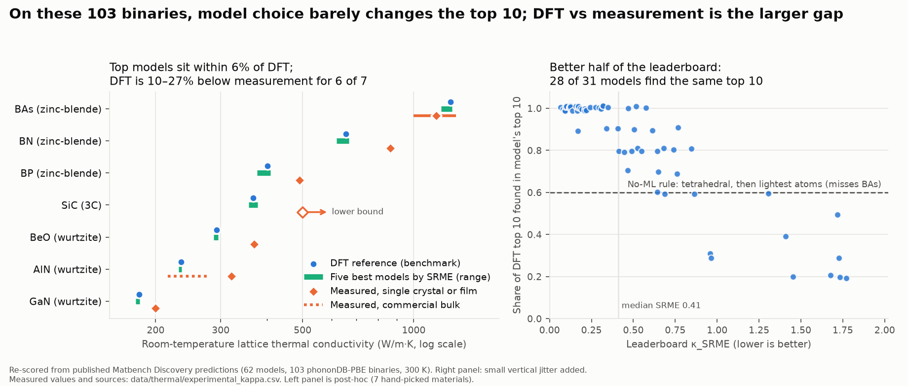

# 芯片散热模块：钱该花在发现新的高导热材料，还是把已知材料装上芯片？

> 2026-11-21。运行记录：`results/thermal_20261121T174521Z/`（配置、环境、输入哈希、逐模型逐材料得分、和排行榜的比对、分析结果、每一步的来历记录 `provenance_*.json`、图）。之前两次运行已作废，原因见"审查后的修正"。

## 商业问题

如果 Google 自己是第一个客户，散热材料的研发钱该花在**发现新的高导热材料**上，还是花在**把已知的高导热材料装进芯片封装**上？

本模块用一个公开评测回答其中可以量化的一段：**在"从候选里找出高导热材料"这一步，AI 模型现在还是瓶颈吗？** 如果不是，差距在哪里。器件化那一段只能靠文献，放在后半部分。

## 用的评测和复现层级

**评测。** [Matbench Discovery](https://github.com/janosh/matbench-discovery)（MIT 许可）的 κ_SRME 任务，方法来自 Póta et al.（arXiv:2408.00755）。103 个简单二元化合物，参考值是 phononDB 的 300 K 晶格热导率，计算设置是 PBE 泛函、三声子散射、不加非解析修正。仓库固定在 commit `6d587c1`（2026-11-15）。

**复现层级：重新计分。** 下载全部 62 个模型公开的预测文件，每个都按仓库里登记的 md5 校验。按官方公式**自己重写**计分代码（`src/thermal/kappa_metrics.py`，没有导入官方函数），再和排行榜比对。

没有重新跑任何声子计算。公开的运行成本是每个模型算完 103 个材料要 0.6 到 8 个 GPU 小时（只有 6 个模型登记了成本），在笔记本上不现实；这一层也已经够回答本模块的问题。

**运行前登记的设计**（`config.json`，在本次运行读任何预测文件之前写入）：
- **分档。** 按 DFT 参考热导率分三档：高（≥ 100 W/m·K，17 个）、中（10–100）、低（< 10）；另设"超过铜"（≥ 400，5 个：两种 BAs、两种 BN、闪锌矿 BP）。分档界线是看过参考值、还没看任何模型预测时定的。
- **筛选指标。** 前 5 / 前 10 召回率：DFT 热导率前 k 名里，模型也排进前 k 的比例。另有 log κ 的 Spearman 相关，以及高档的平均 SRE 和 SRD。
- **说明。** 第一次运行时已经读过预测文件，后两次运行的设计和第一次逐字相同，所以"运行前登记"只在每次运行之内成立。

**事后分析。** 下面这些都是看过第一次结果才设计的，输出文件里标了 `post-hoc`：高档和其余材料的误差差值、按中位数把模型分成两半、经验规则基线、与实测值的对比。

## 结果

**一句话：在这 103 个简单二元化合物上，排行榜较好的那一半模型给出的"前 10 名"几乎相同，模型之间的差别已经不改变筛选结论。和它们差不多一致的 DFT 参考值，对七个有商业意义的材料中的六个，比实测低 10–27%（BAs 在实测范围内）。文献显示，已知高导热材料卡在界面、晶体尺寸和品质上。这些支持"在已知的简单材料上，器件化比发现更紧"这个推断；对复杂的新材料，这个评测说明不了什么。**



### 1. 重新计分和排行榜一致

- **聚合指标。** 62 个模型的 κ_SRME、SRE、SRD 和失败率，与排行榜的差值都不超过 5×10⁻⁵，也就是四舍五入的误差（`leaderboard_check.csv`）。
- **逐材料。** 审查代理按官方代码逐行移植了一份逐材料计算（官方代码要 Python 3.14，不能直接导入），在全部 6,386 个"模型 × 材料"上，SRD、SRME 的差都是 0，失败标记没有一处不同。这份检查保存在 `tests/check_thermal_official_port.py`。

### 2. 高导热档的误差没有更大，但普遍偏低

- **误差大小。** 原来的假设是高导热材料上误差更大，结果不支持。
    - 不做多重检验校正时，62 个模型里有 4 个在高档的 SRE 显著大于其余 86 个材料，16 个显著更小。按 5% 的水平，单侧本来就会有约 1.6 个碰巧显著。
    - 用 Benjamini–Hochberg 校正后，高档更差的剩 1 个，更好的剩 12 个（`tier_summary.json`）。
- **误差方向。** 只看预测成功的材料，46 个模型在高档上的 SRD 区间整体小于 0，也就是系统性地**低估**高导热材料；没有一个模型显著高估。
    - 前列模型低估得很少：前 5 名的高档 SRD 在 −0.03 到 0 之间。
    - 老一代模型低估得多，例如 CHGNet −1.8，它的高档预测没有失败。
    - 另有 14 个模型在高档上至少有一个材料预测失败。失败的预测按官方规则记 SRD = −2，所以这里单独报，不算作"低估"。
- 对筛选来说，整体偏低不一定要紧，因为排序可能不变；要紧的是排序，见下一条。

### 3. 排行榜指标和筛选结论：较好的那一半里已经分不出来

| 比较范围 | κ_SRME 排名 与 高档 SRE 排名 | 与 log κ 相关的排名 | 与 前 10 召回率排名 |
|---|---|---|---|
| 全部 62 个模型 | 0.97 [0.94, 0.97] | 0.96 [0.94, 0.98] | 0.87 |
| SRME 低于中位数 0.41 的 31 个 | 0.90 [0.83, 0.92] | 0.92 [0.78, 0.93] | 0.34 |

表里是两种模型排名之间的 Spearman 相关，方括号是按材料、在档内重抽 2,000 次的 bootstrap 区间（`saturation.json`）。前 10 召回率只给点估计：有放回重抽会让同一材料重复出现，"前 10 名"本身就变了，区间没有意义。

- **大方向一致。** 在全部模型里，κ_SRME 好的模型筛选也好，排行榜指标没有误导。
- **较好的一半分不出来。** 31 个模型里有 28 个前 10 召回率是 1.0，其余 0.9。在这一半里，κ_SRME 的高低基本不改变"前 10 名是哪些"。
- **饱和有一部分是测试集造成的。** DFT 前 10 名其实是 5 个化合物各两种晶型（BAs、BN、BP、SiC、BeO）。第 10 名纤锌矿 BeO 是 293 W/m·K，第 11 名 AlN 是 234，差 25%。误差在 5% 左右的模型改变不了这个集合。所以"κ_SRME 再降也不改变结论"只说明**这个测试集**的前 10 名和后面分得很开，不说明模型已经够用于发现新材料。
- **前 5 召回率稍严格一些。** 16 个模型是 1.0；SRME 低于 0.2 的 19 个模型都在 0.8 以上，而且都把两种 BAs 排进了前 5。

### 4. 不用机器学习的经验规则：找到 6 个，漏掉 BAs

Slack 的经典经验是：轻原子、简单的四面体结构，热导率高。按"先四面体结构（闪锌矿、纤锌矿），再按平均原子质量从轻到重"排序，前 10 召回率是 0.6，log κ 相关 0.79（`rule_baselines.json`，事后分析）。

- **0.6 的余量很窄。** 两种 BP 排在第 11、12 名，只比 BeS 重一点点。
- **漏掉的是 BAs。** 参考值排前两位的两种 BAs，在这条规则里排第 21、22 名，因为砷很重。
- **计算的价值正好在规则失效的地方。** BAs 的高热导率是先由计算预测（Lindsay、Broido 和 Reinecke 2013，PRL 111:025901），2018 年才在实验中测到的。在这 103 个材料里，SRME 低于 0.2 的模型都把两种 BAs 排进了前 5。
- 这和电池模块是同一个教训：衡量 AI 的价值，基线应该是领域规则，不是随机。

### 5. 参考值本身离实测有多远（事后分析，n = 7）

七个有商业意义的高导热材料，实测值和出处在 `data/thermal/experimental_kappa.csv`，完整的文献记录在 `data/thermal/literature_sources.csv`（编号 T001–T024）：

| 材料（相） | DFT 参考 | 前 5 名模型 | 实测 | DFT 相对实测 |
|---|---|---|---|---|
| BAs（闪锌矿） | 1258 | 1188–1270 | 1000–1300 | +9%（在实测范围内） |
| BN（立方） | 656 | 617–667 | 850–880 | −24% |
| BP（闪锌矿） | 402 | 377–410 | 490 | −18% |
| SiC（3C） | 368 | 357–378 | > 500（下限） | 至少 −26% |
| BeO（纤锌矿） | 293 | 287–295 | 370 | −21% |
| AlN（纤锌矿） | 234 | 231–235 | 321（本征）；商用块材 216–278 | −27%（对本征值） |
| GaN（纤锌矿） | 180 | 176–181 | 约 200 | −10% |

单位 W/m·K，室温，天然同位素。"DFT 相对实测"用实测范围的中点。七个材料是手选的，没有区间，只作描述。

- **两种误差的大小不同。** 前 5 名模型相对 DFT 的差别，中位数 2.9%，最大 6.2%；DFT 相对实测，中位数 21%。前 5 名模型是按同一个评测上的 SRME 选出来的，又继承了 DFT 的误差，所以它们相对实测的差别也是 21% 左右。**能说的只是**：对这几个材料，换一个更好的模型，离实测并不会更近；要离实测更近，得改参考计算本身。
- **AlN 的商用块材（216–278）把 DFT 值包在里面。** 器件实际用到的材料，品质往往达不到本征值。
- **BAs 的吻合可能是巧合。** 只算三声子散射时，文献给天然 BAs 的值是 2241，加上四声子散射降到 1417（Feng、Lindsay 和 Ruan 2017，PRB 96:161201）。本评测同样只算三声子，却得到 1258，原因这次没查清。2025 年还有一篇报告测到 2100 以上，作者说现有理论解释不了（只读了 arXiv 摘要，期刊信息未核实）。
- **评测里的相不都是商用的相。** 商用 SiC 主要是 4H，评测里只有 3C 和 2H；评测里还有闪锌矿 AlN、GaN、BeO，它们都不是常用的相。金刚石和硅不在 103 个材料里。
- **DFT 为什么系统性偏低**（PBE 力常数、收敛设置还是别的），这次没有检验。

### 6. 从"测到高热导率"到"装进封装"卡在哪里（文献）

每条后面的编号对应 `data/thermal/literature_sources.csv` 里的一行，有链接或 DOI、读到的层级（原文全文、原文摘要、二手）和阅读日期。11 条没有找到可打开的链接，表里写明了。

**金刚石。**
- **界面热阻。** GaN 和金刚石之间的界面热阻，常见 20–30 m²K/GW（T028，T029）。已报道的低值是 3.1（Malakoutian et al. 2021，T025，只读摘要）。不加 SiC 过渡层时是 107，加了是 30（Field et al. 2020，T026，只读摘要）。
- **热膨胀不匹配。** GaN 的热膨胀系数是 5.6×10⁻⁶/K，金刚石是 0.8×10⁻⁶/K。高温生长会让晶圆翘曲、GaN 开裂（T030）。
- **综述的判断。** Mendes et al. 2022（Materials 15:415）认为，GaN/金刚石的界面热阻和初始金刚石层的质量是目前散热的瓶颈（T031）。
- **商业进展。**
    - 截至 2022 年，已有 GaN-on-金刚石器件在卖（T032）。
    - Akash 2026-03-03 的公告说用金刚石散热的 GPU 服务器温度降最多 10 °C，这是公司说法，没有独立测试（T033，T034）。
    - Diamond Foundry 2026-11-11 宣布的 200 mm 单晶没有质量数据，而且只读到行业媒体的转述（T039，二手）。
    - 没有找到成本数据。

**立方 BAs。**
- **界面。** GaN–BAs 界面导热约 250 MW/m²K，即约 4 m²K/GW（Kang et al. 2021，Nat. Electron.，T041；换算是研究代理自己算的）。
- **尺寸是硬约束。** Cheng et al. 2022（Nat. Commun.）说 BAs、cBN、BP 的晶体还只有毫米级或更小，长不大是规模化制造的障碍（T044）。没有找到晶圆级的 BAs，也没有找到做 BAs 的创业公司（T047，搜索结果为空，不等于不存在）。
- **另一条路。** 把 BAs 颗粒做成导热界面材料，在功率 LED 上把热点温度最多降了 45 °C（Cui et al. 2021，T046，只读摘要）。

**AlN。**
- **已经在用。** 陶瓷 AlN 早已用在功率模块里，约 170 W/m·K（T049，厂商数据表）。
- **差距在品质，不在发现。** 商用块材实测 216–278，本征值 321，差距归因于空位和杂质（Cheng et al. 2020，T016，T017）。
- **单晶衬底。** 2023 年才做到 4 英寸，主要用于紫外 LED（T051，T052）。

**需求侧：加速器散热卡在哪里。**
- **TSMC。** 2026-09-02 在 SEMICON Taiwan 的报告预计封装功率从约 600 W 涨到 4100 W，并说导热界面材料增加热阻，路线是减少或去掉界面层（T061，T062，都是二手转述）。
- **微软。** 微流体冷却的文章说，冷板受限于把热困住的封装层；实验室规模下，散热能力最多是冷板的 3 倍（T058–T060）。文章本身没写日期，"2025 年 9 月"是从图片链接推断的。

**读法。** 已知的高导热材料，在实验室里早就测到了和铜相当或更高的值。文献里卡住它们的是：界面热阻、晶体尺寸、热膨胀匹配、商用品级达不到本征值，以及封装层本身。这些都不是"再发现一个新材料"能直接解决的。需求侧的证据大多是二手转述或公司说法，比材料侧的证据弱。

## 这个结果能改变什么决策

> **2026-11-21 更新：** 之后做了一次事先定好退出条件的商业证据关卡（`COMMERCIAL_EVIDENCE_GATE.md`）。问题本身和规模有一手依据，验收指标已知；但买家一侧的一手来源都指向冷却架构（微流体、液冷、去掉界面层），没有一手证据表明买家需要新材料。按事先定好的规则，散热方向降为"观察"，下表中"器件化看起来比发现更紧"那一行的工作假设不再作为投资依据。

整节都是推断。依据是：一个 103 个简单二元化合物的计算评测；7 个材料的实测对比；以及研究代理整理、其中约三分之一只读到二手转述的文献。

| 决策 | 依据 | 建议（推断） |
|---|---|---|
| 要不要为了找导热材料，继续投钱提高通用模型在 κ_SRME 上的分数？ | 在这个测试集上，较好的一半模型的前 10 名几乎相同；但这部分是因为测试集前 10 名和后面分得很开 | **这个评测不能作为投资理由。** 要判断模型是否还限制发现，需要一个前几名挨得更近、包含复杂结构的测试集 |
| 计算这一侧还值得投什么？ | 对 7 个材料中的 6 个，参考值比实测低 10–27%，BAs 的吻合原因不清 | 优先看**参考计算的物理**：四声子散射、同位素和缺陷散射，以及和实测数据的系统对比。这决定计算排名能不能被实验室信任 |
| 发现新材料，还是器件化已知材料？ | 文献里，已知材料卡在界面、尺寸、品质和封装层；需求侧的公开说法也指向界面和封装，但多为二手 | **对已知的简单材料，器件化看起来比发现更紧**，可以作为研发分配的工作假设。下结论之前，需要用一手资料核实需求侧的说法，并拿到界面和封装层的热阻拆分 |
| 哪一段内部做，哪一段找伙伴？ | 公开资料里，大尺寸金刚石和 AlN 单晶由少数几家公司在推进（T035–T040，T051）；本模块没有评估任何一家 | 晶体和晶圆的供应适合找外部伙伴；界面、封装热设计和在自家加速器上的验证离芯片团队近，适合内部做。具体伙伴需要单独评估 |
| 什么情况下应回头投"发现"？ | 本评测只覆盖简单二元化合物 | 如果有证据表明，复杂化合物或新结构里有容易制造、界面也更好的材料，再把发现放回优先级。下一步可以用一个包含复杂结构的热导率数据集，看模型在那里是否还分不出高低 |

"瓶颈在把已知材料做出来、装上去，而不是缺新材料"这个假设，和系列文章超导篇的判断一致。在这 103 个材料和这几种已知材料上，它得到支持；超出这个范围，还没有被检验。

## 审查后的修正

运行之后请了一个独立代理审查代码、数字和报告。它确认了：62 个模型全部和排行榜一致；逐材料计算和官方逻辑完全相同；报告里的数字都能从文件里重算出来。它也指出了下面这些问题，已经按这样改了：

- **必须改的四处：**
    - 前 10 召回率的 bootstrap 区间不对：有放回重抽会让"前 10 名"本身变成别的集合。现在只给点估计和"31 个里 28 个"这个计数。
    - 补了测试集前 10 名和第 11 名差 25% 这一点，把"饱和"限定在这个测试集上。
    - 第 6 节原来没有可追溯的出处，现在每条对应 `literature_sources.csv` 里的一行。
    - 删掉了"参考值误差是模型误差的七倍"这个说法（两者不可比），改成同时给出模型相对实测的误差，并标为事后分析。
- **应该改的：**
    - 失败预测记 SRD = −2，原来混进了"低估"，现在单独报。
    - 所有事后分析都在输出文件和报告里标明。
    - 高档 SRE 的 bootstrap 原来会丢掉重复抽到的材料，已改。
    - "4 个模型显著更差"补了多重检验校正。
    - 图的标题改得更窄；SiC 画成下限；AlN 加了商用块材范围；"SRME ≈ 0.3"这个没算过的界线改成实际的中位数 0.41。
    - 决策表里的推断都标为推断，去掉了没有出处的说法。
    - 每一步输出都带来历记录：时间、种子、输入文件哈希、代码文件哈希、包版本。
- **次要的：** 计分代码补齐了几处在这份数据上不会触发、但和官方不一致的边界情况（多温度、模式张量的另一种存法、分母为零、缺材料时报错、负权重）。
- **作废的运行：**
    - `superseded_thermal_20261121T165139Z_mode_tensor_bug`：9 个模型的模式张量没读对，全部记成失败。
    - `superseded_thermal_20261121T170251Z_pre_review`：审查之前的版本。

## 局限

- **参考值是 DFT，不是实测。** 计算方法是 PBE、三声子、不加非解析修正。
- **范围很窄。** 只有 103 个简单二元化合物，前 10 名和后面分得很开。金刚石、硅、4H-SiC 不在里面，另有几个不是常用的相。结论不能推到复杂化合物、合金、薄膜或界面上。
- **训练数据可能见过这些结构。** 这些都是很常见的化合物，较新的大训练集里很可能有相同或相近的结构，这次没有检查。如果有，前列模型的高分里有一部分是记忆。
- **只到重新计分这一层。** 没有自己重算声子，也没有检查各模型提交时的设置是否一致。
- **晶格热导率不等于器件散热。** 器件里的热流还取决于界面、厚度、缺陷、温度和封装结构。
- **文献由研究代理整理。** 63 条里 22 条只读到二手转述，11 条没有找到可打开的链接；成本数据都没有公开来源。
- **代码版本。** 项目还不是 git 仓库，代码用文件哈希标识（`provenance_*.json`），建仓库后补上 commit。

## 复现

```bash
cd materials-intelligence
.venv/bin/python -I src/thermal/fetch_kappa.py          # 约 600 MB，按 md5 校验
.venv/bin/python src/thermal/run_rescore.py
.venv/bin/python src/thermal/analyze_thermal.py results/<run_id>
.venv/bin/python src/thermal/compare_experiment.py results/<run_id>
.venv/bin/python src/thermal/plot_thermal.py results/<run_id>
.venv/bin/python tests/check_thermal_official_port.py data/raw/kappa/<commit> results/<run_id>   # 逐材料对照官方逻辑
```

---

## English version

### Chip cooling module: should the money go to discovering new high-thermal-conductivity materials, or to putting known materials on chips?

> 2026-11-21. Run record: `results/thermal_20261121T174521Z/` (config, environment, input hashes, per-model per-material scores, comparison with the leaderboard, analysis results, a provenance record for each step `provenance_*.json`, figures). Two earlier runs were superseded; the reasons are in "Fixes after review".

### Business question

If Google itself is the first customer, should R&D money for thermal materials go to **discovering new high-thermal-conductivity materials**, or to **putting known high-thermal-conductivity materials into chip packages**?

This module uses a public benchmark to answer the part that can be quantified: **in the step "find the high-thermal-conductivity materials among the candidates", are AI models still the bottleneck?** If not, where is the gap? The device integration part can only rely on the literature; it is in the second half.

### Benchmark used and reproduction level

**Benchmark.** The κ_SRME task of [Matbench Discovery](https://github.com/janosh/matbench-discovery) (MIT license), with the method from Póta et al. (arXiv:2408.00755). It has 103 simple binary compounds. The reference values are phononDB lattice thermal conductivities at 300 K. The computational settings are the PBE functional, three-phonon scattering, and no non-analytical correction. The repository is pinned at commit `6d587c1` (2026-11-15).

**Reproduction level: re-score.** I downloaded the public prediction files of all 62 models and checked each against the md5 registered in the repository. I **rewrote** the scoring code from the official formulas (`src/thermal/kappa_metrics.py`, no official functions imported), then compared it with the leaderboard.

No phonon calculations were re-run. The public run cost is 0.6 to 8 GPU hours per model for all 103 materials (only 6 models registered a cost). That is not practical on a laptop, and this level is already enough to answer this module's question.

**Design registered before the run** (`config.json`, written before this run read any prediction file):
- **Tiers.** Three tiers by DFT reference thermal conductivity: high (≥ 100 W/m·K, 17 materials), medium (10–100), low (< 10). There is also an "above copper" group (≥ 400, 5 materials: two BAs, two BN, zinc-blende BP). The tier boundaries were set after looking at the reference values and before looking at any model prediction.
- **Screening metrics.** Recall@5 / recall@10: the share of the top k by DFT thermal conductivity that the model also ranks in its top k. Also the Spearman correlation of log κ, and the mean SRE and SRD of the high tier.
- **Note.** The first run had already read the prediction files. The design of the two later runs is word for word the same as the first, so "registered before the run" holds only within each run.

**Post-hoc analysis.** All of the following were designed after seeing the first results, and are marked `post-hoc` in the output files: the error difference between the high tier and the other materials, splitting the models into two halves at the median, the rule-of-thumb baseline, and the comparison with measured values.

### Results

**In one sentence: on these 103 simple binary compounds, the "top 10" given by the better half of the leaderboard models is almost the same, and differences between models no longer change the screening conclusion. The DFT reference values, which these models roughly agree with, are 10–27% below measured values for six of the seven commercially relevant materials (BAs is within the measured range). The literature shows that known high-thermal-conductivity materials are held back by interfaces, crystal size and quality. These support the inference "for known simple materials, device integration is tighter than discovery"; for complex new materials, this benchmark says nothing.**


#### 1. The re-score matches the leaderboard

- **Aggregate metrics.** For all 62 models, κ_SRME, SRE, SRD and failure rate differ from the leaderboard by no more than 5×10⁻⁵, which is rounding error (`leaderboard_check.csv`).
- **Per material.** The review agent ported the official code line by line into a per-material calculation (the official code needs Python 3.14 and cannot be imported directly). Across all 6,386 "model × material" pairs, the differences in SRD and SRME are all 0, and no failure flag differs. This check is saved in `tests/check_thermal_official_port.py`.

#### 2. Errors in the high-κ tier are not larger, but are generally low

- **Error size.** The original hypothesis was that errors are larger on high-thermal-conductivity materials. The results do not support it.
    - Without multiple-testing correction, 4 of the 62 models have a high-tier SRE significantly larger than on the other 86 materials, and 16 have one significantly smaller. At the 5% level, about 1.6 would be significant on one side by chance alone.
    - After Benjamini–Hochberg correction, 1 model remains worse on the high tier and 12 remain better (`tier_summary.json`).
- **Error direction.** Looking only at materials that were predicted successfully, 46 models have a high-tier SRD interval entirely below 0. That is, they systematically **underestimate** high-thermal-conductivity materials. No model significantly overestimates.
    - The leading models underestimate very little: the high-tier SRD of the top 5 is between −0.03 and 0.
    - Older models underestimate more, for example CHGNet at −1.8; it had no failed predictions in the high tier.
    - Another 14 models failed on at least one material in the high tier. Under the official rule a failed prediction is scored SRD = −2, so these are reported separately here and not counted as "underestimation".
- For screening, being low overall does not necessarily matter, because the ranking may not change. What matters is the ranking; see the next item.

#### 3. Leaderboard metric and screening conclusion: no longer distinguishable within the better half

| Comparison scope | κ_SRME rank vs high-tier SRE rank | vs log κ correlation rank | vs recall@10 rank |
|---|---|---|---|
| All 62 models | 0.97 [0.94, 0.97] | 0.96 [0.94, 0.98] | 0.87 |
| The 31 with SRME below the median 0.41 | 0.90 [0.83, 0.92] | 0.92 [0.78, 0.93] | 0.34 |

The table shows Spearman correlations between two model rankings. The brackets are bootstrap intervals from 2,000 resamples by material, within tier (`saturation.json`). Recall@10 has only a point estimate: resampling with replacement makes the same material appear more than once, so the "top 10" itself changes, and an interval has no meaning.

- **The broad direction agrees.** Across all models, models with a good κ_SRME also screen well. The leaderboard metric is not misleading.
- **The better half cannot be separated.** 28 of the 31 models have a recall@10 of 1.0; the rest have 0.9. Within this half, the level of κ_SRME largely does not change "which materials are in the top 10".
- **The saturation is partly caused by the test set.** The DFT top 10 is in fact 5 compounds with two polymorphs each (BAs, BN, BP, SiC, BeO). No. 10, wurtzite BeO, is 293 W/m·K; No. 11, AlN, is 234, a 25% gap. A model with errors around 5% cannot change this set. So "lowering κ_SRME further does not change the conclusion" only shows that the top 10 of **this test set** is well separated from the rest. It does not show that the models are good enough for discovering new materials.
- **Recall@5 is somewhat stricter.** 16 models score 1.0. All 19 models with SRME below 0.2 score 0.8 or higher, and all of them put both BAs in the top 5.

#### 4. A rule of thumb without machine learning: finds 6, misses BAs

Slack's classic rule of thumb: light atoms and simple tetrahedral structures give high thermal conductivity. Ranking by "tetrahedral structures first (zinc blende, wurtzite), then by average atomic mass from light to heavy" gives a recall@10 of 0.6 and a log κ correlation of 0.79 (`rule_baselines.json`, post-hoc analysis).

- **The 0.6 has a narrow margin.** The two BP are ranked 11th and 12th, only slightly heavier than BeS.
- **What it misses is BAs.** The two BAs, ranked first and second by reference value, come 21st and 22nd under this rule, because arsenic is heavy.
- **The value of computation is exactly where the rule fails.** The high thermal conductivity of BAs was first predicted by computation (Lindsay, Broido and Reinecke 2013, PRL 111:025901) and only measured in experiment in 2018. Among these 103 materials, the models with SRME below 0.2 all put both BAs in the top 5.
- This is the same lesson as in the battery module: to measure the value of AI, the baseline should be a domain rule, not random.

#### 5. How far the reference values themselves are from measurement (post-hoc analysis, n = 7)

Seven commercially relevant high-thermal-conductivity materials. Measured values and their sources are in `data/thermal/experimental_kappa.csv`; the full literature record is in `data/thermal/literature_sources.csv` (IDs T001–T024):

| Material (phase) | DFT reference | Top 5 models | Measured | DFT vs measured |
|---|---|---|---|---|
| BAs (zinc blende) | 1258 | 1188–1270 | 1000–1300 | +9% (within the measured range) |
| BN (cubic) | 656 | 617–667 | 850–880 | −24% |
| BP (zinc blende) | 402 | 377–410 | 490 | −18% |
| SiC (3C) | 368 | 357–378 | > 500 (lower bound) | at least −26% |
| BeO (wurtzite) | 293 | 287–295 | 370 | −21% |
| AlN (wurtzite) | 234 | 231–235 | 321 (intrinsic); commercial bulk 216–278 | −27% (vs the intrinsic value) |
| GaN (wurtzite) | 180 | 176–181 | about 200 | −10% |

Units are W/m·K, room temperature, natural isotopes. "DFT vs measured" uses the midpoint of the measured range. The seven materials were picked by hand and have no intervals; this is descriptive only.

- **The two errors differ in size.** The top 5 models differ from DFT by a median of 2.9% and a maximum of 6.2%; DFT differs from measurement by a median of 21%. The top 5 models were selected by SRME on the same benchmark and inherit the DFT error, so their difference from measurement is also about 21%. **All that can be said is**: for these materials, switching to a better model does not get closer to measurement; to get closer, the reference calculation itself has to change.
- **The commercial bulk range for AlN (216–278) brackets the DFT value.** Materials actually used in devices often do not reach intrinsic quality.
- **The BAs agreement may be a coincidence.** With three-phonon scattering only, the literature gives 2241 for natural BAs; adding four-phonon scattering lowers it to 1417 (Feng, Lindsay and Ruan 2017, PRB 96:161201). This benchmark also uses three-phonon scattering only, yet gets 1258. The reason was not found this time. A 2025 report also measured above 2100, and its authors say existing theory cannot explain it (only the arXiv abstract was read; the journal information is not verified).
- **The phases in the benchmark are not all commercial phases.** Commercial SiC is mainly 4H; the benchmark has only 3C and 2H. The benchmark also has zinc-blende AlN, GaN and BeO, none of which are commonly used phases. Diamond and silicon are not among the 103 materials.
- **Why DFT is systematically low** (PBE force constants, convergence settings, or something else) was not tested this time.

#### 6. Where things get stuck between "high thermal conductivity measured" and "fitted into the package" (literature)

The ID after each item matches a row in `data/thermal/literature_sources.csv`, with a link or DOI, the level read (original full text, original abstract, secondhand) and the reading date. For 11 items no link that opens was found; the table says so.

**Diamond.**
- **Interface thermal resistance.** The interface thermal resistance between GaN and diamond is commonly 20–30 m²K/GW (T028, T029). A reported low value is 3.1 (Malakoutian et al. 2021, T025, abstract only). Without an SiC transition layer it is 107; with one it is 30 (Field et al. 2020, T026, abstract only).
- **Thermal expansion mismatch.** The thermal expansion coefficient of GaN is 5.6×10⁻⁶/K and that of diamond is 0.8×10⁻⁶/K. High-temperature growth causes wafer bow and GaN cracking (T030).
- **The review's judgment.** Mendes et al. 2022 (Materials 15:415) consider the GaN/diamond interface thermal resistance and the quality of the initial diamond layer to be the current bottleneck for heat removal (T031).
- **Commercial progress.**
    - As of 2022, GaN-on-diamond devices were on sale (T032).
    - Akash's 2026-03-03 announcement says GPU servers with diamond cooling run up to 10 °C cooler. This is a company claim with no independent test (T033, T034).
    - The 200 mm single crystal announced by Diamond Foundry on 2026-11-11 has no quality data, and only a trade-media retelling was read (T039, secondhand).
    - No cost data was found.

**Cubic BAs.**
- **Interface.** The GaN–BAs interface thermal conductance is about 250 MW/m²K, that is about 4 m²K/GW (Kang et al. 2021, Nat. Electron., T041; the conversion was done by the research agent itself).
- **Size is a hard constraint.** Cheng et al. 2022 (Nat. Commun.) say that BAs, cBN and BP crystals are still millimetre-scale or smaller, and that the inability to grow them larger is an obstacle to scaled manufacturing (T044). No wafer-scale BAs was found, and no startup making BAs was found (T047; the search returned nothing, which does not mean none exists).
- **Another path.** BAs particles made into a thermal interface material lowered the hot-spot temperature of power LEDs by up to 45 °C (Cui et al. 2021, T046, abstract only).

**AlN.**
- **Already in use.** Ceramic AlN has long been used in power modules, at about 170 W/m·K (T049, vendor datasheet).
- **The gap is in quality, not discovery.** Commercial bulk measures 216–278 and the intrinsic value is 321. The gap is attributed to vacancies and impurities (Cheng et al. 2020, T016, T017).
- **Single-crystal substrates.** 4-inch substrates were only reached in 2023, mainly for UV LEDs (T051, T052).

**Demand side: where accelerator cooling is stuck.**
- **TSMC.** A 2026-09-02 talk at SEMICON Taiwan projects package power rising from about 600 W to 4100 W, and says thermal interface materials add thermal resistance and the path is to reduce or remove interface layers (T061, T062, both secondhand retellings).
- **Microsoft.** The microfluidic cooling article says cold plates are limited by package layers that trap heat; at lab scale, heat removal is up to 3 times that of cold plates (T058–T060). The article itself has no date; "September 2025" was inferred from an image link.

**How to read this.** Known high-thermal-conductivity materials were measured in the lab long ago at values equal to or above copper. In the literature, what holds them back is interface thermal resistance, crystal size, thermal expansion matching, commercial grades not reaching intrinsic values, and the package layers themselves. None of these can be solved directly by "discovering one more new material". The demand-side evidence is mostly secondhand retellings or company claims, and is weaker than the material-side evidence.

### What decisions this result can change

> **2026-11-21 update:** A commercial evidence gate with exit conditions set in advance was run afterwards (`COMMERCIAL_EVIDENCE_GATE.md`). The problem itself and its scale have primary-source support, and the acceptance metrics are known. But the buyer-side primary sources all point to cooling architecture (microfluidics, liquid cooling, removing interface layers), and there is no primary-source evidence that buyers need new materials. Under the rule set in advance, the thermal direction is downgraded to "watch", and the working hypothesis in the row "device integration looks tighter than discovery" in the table below is no longer used as a basis for investment.

This whole section is inference. It rests on a computational benchmark of 103 simple binary compounds; a comparison with measured values for 7 materials; and literature compiled by the research agent, of which about one third was read only as secondhand retellings.

| Decision | Basis | Recommendation (inference) |
|---|---|---|
| Should we keep investing to raise general models' κ_SRME scores in order to find thermal materials? | On this test set, the top 10 of the better half of the models is almost the same; but this is partly because the test set's top 10 is well separated from the rest | **This benchmark cannot serve as a reason to invest.** To judge whether models still limit discovery, a test set is needed whose top candidates are closer together and which includes complex structures |
| What is still worth investing in on the computation side? | For 6 of the 7 materials, the reference values are 10–27% below measurement; the reason for the BAs agreement is unclear | Look first at **the physics of the reference calculation**: four-phonon scattering, isotope and defect scattering, and a systematic comparison with measured data. This decides whether labs can trust computed rankings |
| Discover new materials, or bring known materials to device integration? | In the literature, known materials are held back by interfaces, size, quality and package layers; public demand-side statements also point to interfaces and packaging, but are mostly secondhand | **For known simple materials, device integration looks tighter than discovery**, and can serve as a working hypothesis for R&D allocation. Before a conclusion, the demand-side statements need checking against primary sources, and a breakdown of thermal resistance into interface and package layers is needed |
| Which part to do in-house, which with partners? | In public sources, large diamond and AlN single crystals are being pushed by a few companies (T035–T040, T051); this module did not evaluate any of them | Crystal and wafer supply suits external partners. Interfaces, package thermal design and validation on our own accelerators sit close to the chip team and suit in-house work. Specific partners need a separate evaluation |
| When should investment go back to "discovery"? | This benchmark covers only simple binary compounds | If evidence shows that complex compounds or new structures contain materials that are easy to manufacture and have better interfaces, put discovery back among the priorities. A next step could use a thermal conductivity dataset that includes complex structures, to see whether the models still cannot be told apart there |

The hypothesis "the bottleneck is making known materials and fitting them, not a lack of new materials" matches the judgment in the superconductor piece of the article series. On these 103 materials and these few known materials it is supported; beyond this scope it has not been tested.

### Fixes after review

After the run, an independent agent was asked to review the code, the numbers and the report. It confirmed that all 62 models match the leaderboard, that the per-material calculation is identical to the official logic, and that every number in the report can be recomputed from the files. It also pointed out the following issues, which were fixed as follows:

- **Four must-fix items:**
    - The bootstrap interval for recall@10 was wrong: resampling with replacement turns the "top 10" itself into a different set. Now only the point estimate and the count "28 of 31" are given.
    - Added the point that the test set's top 10 and No. 11 differ by 25%, which limits "saturation" to this test set.
    - Section 6 originally had no traceable sources; now each item matches a row in `literature_sources.csv`.
    - Removed the claim "the reference-value error is seven times the model error" (the two are not comparable). Replaced it by also giving the model error against measurement, marked as post-hoc analysis.
- **Should-fix items:**
    - Failed predictions, scored SRD = −2, had been mixed into "underestimation"; they are now reported separately.
    - All post-hoc analyses are marked in the output files and in the report.
    - The bootstrap for high-tier SRE used to drop materials that were drawn more than once; fixed.
    - Added multiple-testing correction to "4 models significantly worse".
    - The figure titles were narrowed; SiC is drawn as a lower bound; AlN has the commercial bulk range added; the uncomputed boundary "SRME ≈ 0.3" was changed to the actual median of 0.41.
    - All inferences in the decision table are marked as inferences, and claims without a source were removed.
    - Every step's output carries a provenance record: time, seed, input file hashes, code file hashes, package versions.
- **Minor:** The scoring code now handles several edge cases that do not trigger on this data but differed from the official code (multiple temperatures, another storage format for the mode tensor, a zero denominator, raising an error on missing materials, negative weights).
- **Superseded runs:**
    - `superseded_thermal_20261121T165139Z_mode_tensor_bug`: the mode tensors of 9 models were not read correctly, and all were recorded as failures.
    - `superseded_thermal_20261121T170251Z_pre_review`: the version before the review.

### Limitations

- **The reference values are DFT, not measurement.** The method is PBE, three-phonon scattering, no non-analytical correction.
- **The scope is narrow.** Only 103 simple binary compounds, with the top 10 well separated from the rest. Diamond, silicon and 4H-SiC are not included, and several phases are not commonly used ones. The conclusions cannot be extended to complex compounds, alloys, thin films or interfaces.
- **The training data may have seen these structures.** These are common compounds, and newer large training sets very likely contain the same or similar structures. This was not checked. If they do, part of the leading models' high scores is memorization.
- **Only at the re-score level.** I did not recompute phonons, and did not check whether each model's submission settings were consistent.
- **Lattice thermal conductivity is not device cooling.** Heat flow in a device also depends on interfaces, thickness, defects, temperature and package structure.
- **The literature was compiled by the research agent.** Of 63 items, 22 were read only as secondhand retellings, and for 11 no link that opens was found. None of the cost data has a public source.
- **Code version.** The project is not yet a git repository. The code is identified by file hashes (`provenance_*.json`); commits will be added once the repository exists.

### Reproduction

```bash
cd materials-intelligence
.venv/bin/python -I src/thermal/fetch_kappa.py          # about 600 MB, checked by md5
.venv/bin/python src/thermal/run_rescore.py
.venv/bin/python src/thermal/analyze_thermal.py results/<run_id>
.venv/bin/python src/thermal/compare_experiment.py results/<run_id>
.venv/bin/python src/thermal/plot_thermal.py results/<run_id>
.venv/bin/python tests/check_thermal_official_port.py data/raw/kappa/<commit> results/<run_id>   # per-material check against the official logic
```
